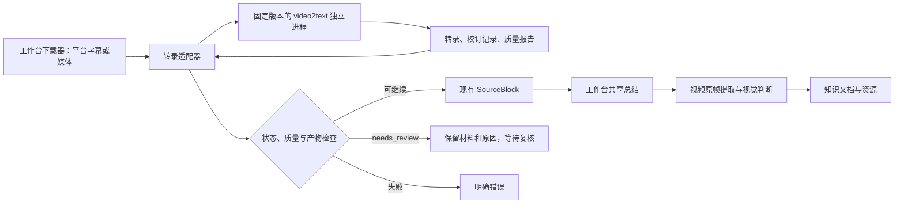

# video2text 适配设计（候选）

更新于 2026-11-17。关联 [FR-07/FR-07a](../需求文档.md)。[video2text](https://github.com/her7tz/video2text) 独立迭代，工作台现阶段沿用自己的转录实现。本页的源码核对仅适用于所列提交。

2026-11-17 通过 GitHub 比对，远端 `main` 仍等同于调研快照 `ab491a0`。这次核对只覆盖远端 `main`。上次已在隔离目录用该提交的 `workbench.py` 和合成 CLI 回执验证三条关键路径，结果见下文。 [GitHub 提交比对](https://github.com/her7tz/video2text/compare/ab491a0b69ebfd3e1e79ea6cf90407df6b79211d...main)

## 职责边界

七步转录流程由外部引擎维护；主 Agent 不依赖它的内部目录、函数或每个 Skill 的提示词。工作台继续负责链接访问、账号边界、任务与取消、知识总结、关键帧、文档保存和知识库。讲义辅助术语与对齐，不作为已讲述内容的替代来源；外仓的 `notes.md` 或 `enhanced.md` 不直接替代工作台的知识总结。

完整 `run --json` 是当前对照入口，可接收已取得的本地媒体或字幕。上游面向外部 Agent 的 `workbench` JSON 接口通过下文的兼容验收后，可作为接入入口。下载仍由工作台处理，沿用游客策略。适配契约及其验收样本归工作台维护，上游可独立调整七步流水线。

## 适配层最小契约

以下是工作台拟采用的边界，尚不是已实现接口。

| 方向 | 必需信息 | 约束 |
| --- | --- | --- |
| 输入 | 本地材料、任务标识、任务独立输出目录；可选讲义、词表 | 原始文件不覆盖；每任务独立目录，避免共享缓存串用 |
| 输入定位 | 材料对应的视频标识、切片起点和内部时间坐标约定 | 保留相对/绝对时间的区别，向关键帧模块交付时只换算一次 |
| 执行配置 | 完整提交号、独立环境、Skill 内容哈希、词表、ASR 模型与质量阈值 | 开始运行后固定快照；不隐式沿用主 Agent 的 API Key |
| 转录输出 | 片段编号、起止秒、`raw_text`、校订后 `text`、`corrections` | 原话与修订均可追溯；保持原始来源编号，适配后生成工作台来源块 |
| 质量输出 | 运行状态、`quality.passed`、指标与原因 | 同时检查结构与必要产物；通过表示既定门控满足，不等于逐字正确 |
| 产物输出 | `raw.json`、`transcript.json`、`quality.json` 及可用字幕/轨迹路径 | 路径属于本任务目录；摘要保存后仍能追溯所用版本和材料 |

`needs_review` 应保留材料和质量原因，停止自动总结，不作为整个视频任务完成。其产品提示和任务状态映射需随接入实现，不能假称已有视频等待复核流程。失败也不能按标题猜总结或自动改用不同引擎掩盖。默认不传 `--export-dataset`。

### 上游实现与接口分别演进

在上游提供独立的协议版本前，适配器按经过验收的提交支持其 JSON 接口。后续可在 `probe` 中增加 `protocol_version`，同时报告是否接受字幕输入、是否能返回结构化复核状态，以及能提供哪些产物。协议版本用于判断接口能否读取，完整提交号用于追溯实际转录实现。两者都保留时，转录精度变化和接口格式变化可以分别验收。

上游可以在同一协议下调整 ASR、术语校订、对齐算法或 Skill。升级仍需用固定样本检查结果是否退化。若字段、状态或产物路径发生不兼容变化，先在适配器中完成映射并通过验收，再启用该提交。

## 源码核对快照

调研固定于提交 [`d8fdd79d4a1eebe57a329399fef5c7f423bd6596`](https://github.com/her7tz/video2text/commit/d8fdd79d4a1eebe57a329399fef5c7f423bd6596)，提交时间为 2026-11-07 07:25:55（北京时间）。此快照仅用于设计依据，未设置为工作台运行依赖。

| 已核对事实 | 对接影响 | 固定源码 |
| --- | --- | --- |
| Python 要求 `>=3.10`；包版本为 `0.1.0` | 独立环境运行；用完整提交号识别实现，包版本不足以区分变化 | [pyproject.toml](https://github.com/her7tz/video2text/blob/d8fdd79d4a1eebe57a329399fef5c7f423bd6596/pyproject.toml#L5-L18) |
| `run` 返回 `task_id/status/stages/artifacts/quality/transcript_source/media`；转录 JSON 为 `{meta,segments}` | 在适配器内解析外仓格式，内部总结只接收工作台来源块 | [运行结果](https://github.com/her7tz/video2text/blob/d8fdd79d4a1eebe57a329399fef5c7f423bd6596/video2text/pipeline.py#L168-L193)、[片段与校订](https://github.com/her7tz/video2text/blob/d8fdd79d4a1eebe57a329399fef5c7f423bd6596/video2text/parsers.py#L42-L78) |
| `run` 门控失败可导出转录，但状态为 `needs_review`、退出码 2；LLM 质量建议不改变确定性门控值 | 检查状态和质量内容，不把“有文件”当成功 | [质量阶段](https://github.com/her7tz/video2text/blob/d8fdd79d4a1eebe57a329399fef5c7f423bd6596/video2text/pipeline.py#L484-L526)、[训练集门控](https://github.com/her7tz/video2text/blob/d8fdd79d4a1eebe57a329399fef5c7f423bd6596/video2text/pipeline.py#L629-L659) |
| 单 Skill 质量检查可同时返回 `ok:true` 与 `report.passed:false`；未审批 Skill 在完整流水线内可转为 failed/退出 1 | README 的通用退出码不能直接充当所有入口的统一协议 | [单 Skill 质量](https://github.com/her7tz/video2text/blob/d8fdd79d4a1eebe57a329399fef5c7f423bd6596/video2text/skillrun.py#L130-L150)、[run 退出映射](https://github.com/her7tz/video2text/blob/d8fdd79d4a1eebe57a329399fef5c7f423bd6596/video2text/cli.py#L280-L306) |
| 完整流水线逐阶段核对 Skill 哈希与审批；单 Skill 入口不做相同检查，且不完整恢复校订及 ASR 指标 | 不承诺任意单 Skill 串接与完整流水线等价；安装成功也不等于审批完成 | [审批](https://github.com/her7tz/video2text/blob/d8fdd79d4a1eebe57a329399fef5c7f423bd6596/video2text/skills/registry.py#L111-L158)、[单 Skill 反序列化](https://github.com/her7tz/video2text/blob/d8fdd79d4a1eebe57a329399fef5c7f423bd6596/video2text/skillrun.py#L27-L49) |
| URL 入口使用固定 `data/raw/pipeline_source.m4a`，存在即跳过下载 | 优先复用工作台下载及每任务目录，避免不同视频复用旧音频 | [URL 入口](https://github.com/her7tz/video2text/blob/d8fdd79d4a1eebe57a329399fef5c7f423bd6596/video2text/cli.py#L648-L666) |
| `raw.json` 在对齐前保存，`raw.srt` 使用对齐后的时间与原始文字 | 二者不可当作同一原始快照；分别标明原始文字与原始时间的含义 | [原始 JSON](https://github.com/her7tz/video2text/blob/d8fdd79d4a1eebe57a329399fef5c7f423bd6596/video2text/pipeline.py#L335-L347)、[字幕导出](https://github.com/her7tz/video2text/blob/d8fdd79d4a1eebe57a329399fef5c7f423bd6596/video2text/pipeline.py#L528-L550) |

## 外部 Agent 接口的候选快照

在提交 [`ab491a0`](https://github.com/her7tz/video2text/commit/ab491a0b69ebfd3e1e79ea6cf90407df6b79211d) 核对了 `v2t workbench`。它通过标准输入和标准输出交换 JSON，提供 `probe`（查询能力）、`run`（执行转录）、`artifact`（读取产物）。`probe` 返回的是包版本和动作列表，尚无独立的接口协议版本。候选版本仍需以固定提交及兼容验收为准。 [接口源码](https://github.com/her7tz/video2text/blob/ab491a0b69ebfd3e1e79ea6cf90407df6b79211d/video2text/workbench.py#L16-L54)

| 核对项 | 该提交的行为 | 接入前验证 |
| --- | --- | --- |
| 字幕优先 | 完整 CLI 接受 `--transcript`。`workbench` 的 `run` 要求 `video`，没有转发已有字幕的字段。 | 仅用已有字幕就能进入流程，无需先下载媒体或运行 ASR。 [CLI 输入](https://github.com/her7tz/video2text/blob/ab491a0b69ebfd3e1e79ea6cf90407df6b79211d/video2text/cli.py#L44-L48)、[JSON 请求](https://github.com/her7tz/video2text/blob/ab491a0b69ebfd3e1e79ea6cf90407df6b79211d/video2text/workbench.py#L112-L135) |
| 质量复核 | 完整 CLI 为 `needs_review` 输出 JSON 并返回退出码 2。`workbench` 在解析 JSON 前将所有非零退出码转成通用失败。 | 质量未通过时保留可读原因和产物，暂停自动总结。 [CLI 状态](https://github.com/her7tz/video2text/blob/ab491a0b69ebfd3e1e79ea6cf90407df6b79211d/video2text/cli.py#L283-L310)、[接口解析](https://github.com/her7tz/video2text/blob/ab491a0b69ebfd3e1e79ea6cf90407df6b79211d/video2text/workbench.py#L89-L104) |
| 产物定位 | 完整 CLI 写入 `out/task_id`，结果没有 `output_dir` 或 `run`。按当前源码，包装层会回退到输出根目录，而 `artifact` 从收到的目录直接读取文件。 | 用同一输出根目录运行两个任务，各自准确读回自己的 `transcript.json` 和质量报告。 [输出路径](https://github.com/her7tz/video2text/blob/ab491a0b69ebfd3e1e79ea6cf90407df6b79211d/video2text/cli.py#L255-L257)、[流水线结果](https://github.com/her7tz/video2text/blob/ab491a0b69ebfd3e1e79ea6cf90407df6b79211d/video2text/pipeline.py#L168-L193)、[包装层路径](https://github.com/her7tz/video2text/blob/ab491a0b69ebfd3e1e79ea6cf90407df6b79211d/video2text/workbench.py#L97-L104) |

包装层测试使用一个 SRT 和两个临时任务目录。仅传 SRT 时包装层在调用下层 CLI 前返回缺少 `video`。模拟 CLI 以退出码 2 返回 `needs_review` 时，响应丢失质量状态和指标。两个模拟成功任务返回同一输出根目录，由该路径读取转录均失败；直接提供各自任务目录时均读到对应内容。下层转录、模型和完整命令行尚未联调。

## 升级与回退

1. 试接入时选定一个完整提交号，分别记录待评估提交与已启用提交。任务启动时从已启用版本的独立环境运行，并记录版本和配置。上游 `main` 只用于发现候选，开发中的本机副本用于候选验证。
2. 在独立环境核对该提交的命令入口、JSON 字段、退出码和质量状态，再用同一组原始材料测试三条路径：字幕输入能生成可追溯片段，无字幕输入能产出带时间戳的转录，质量不通过时能保留复核材料并暂停自动总结。也核对时间偏移、取消及任务输出目录。
3. 记录候选提交、实际产物格式，以及新旧版本在术语修正、误改、无依据改写方面的差异。通过后才显式切换后续任务，保留已验证的上一版供回退，历史成果保留对应的来源和版本。
4. 命令或产物协议变化由适配器处理。提交号标识实现快照，兼容性由上述输入、状态和产物验收确认。无法映射到工作台转录契约时，将该提交留在候选阶段并记录原因。

当前已核对上游版本和接口源码，并完成包装层隔离复现。外部引擎接入仍待验收。
