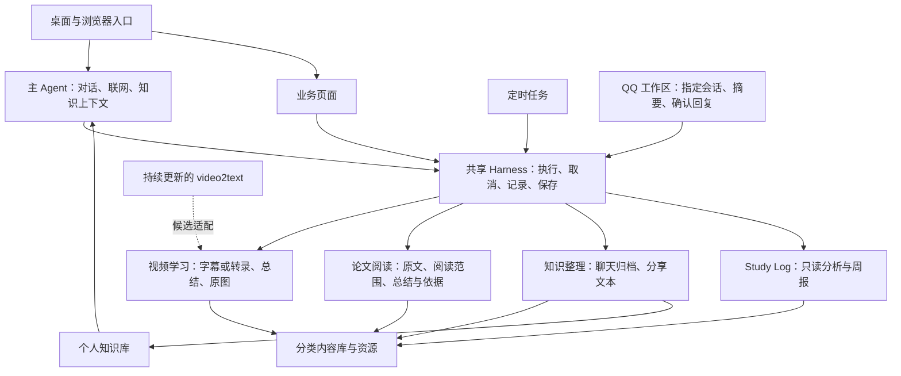

# Agent 工作台交付状态

核对日期：2026-11-20。**当前可本机运行，整体需求仍有实机验收待完成。** 本页集中说明使用入口、当前证据与尚未闭合的条件。完整要求以[需求文档](../需求文档.md)为准。

## 从哪里开始

1. 首次使用，双击项目中的 `配置运行环境.command`。已准备好 `.venv` 时可直接进入下一步。
2. 双击 `启动桌面客户端.command`。它检查项目绑定和桌面包，需要时重新构建，再打开主窗口。首次构建需要 Xcode Command Line Tools。
3. 在 **Agent 设置**保存模型凭证，查询或填写该服务支持的模型编号。主 Agent 和各业务角色可分别配置，也可继承默认值。
4. 主控制台用于对话、联网研究、委派和查询成果；各 Subagent 页面用于直接提交与管理对应任务。正式报告自动保存到内容库，聊天归档时可选择是否提取知识。
5. 关闭主窗口后可从 Dock 或菜单栏恢复。显式退出会停止客户端自己启动的后台。定时执行依赖电脑和服务运行，错过宽限的任务跳过并记录。

桌面包使用本项目的 Python 与页面，不能单独拷贝 `.app` 当作独立安装包。复制项目后应重新配置环境，再从新目录的启动命令进入。

## 模块关系

QQ 材料保持在独立工作区，不自动进入主对话或个人知识库。video2text 外部引擎尚未启用，候选接入规则见[适配设计](video2text适配设计.md)。

## 当前交付证据

| 范围 | 本次核对结果 | 证据边界 |
| --- | --- | --- |
| Python 自动检查 | 启用本机 HTTP 的全套 408 项通过，无跳过 | 包含合成服务和模型。见[第 189 节](实施与验收记录.md#189-qq-好友历史核对私聊类型和收件人2026-11-20) |
| QQ 实号登录与群历史 | NapCat Docker 扫码后返回预期账号并拒绝无效令牌。真实工作台只读连接取得指定群最近 24 小时的六条可整理消息 | 已核对会话隔离、时间范围、去重和断开。覆盖的是日期历史。见[实机验收](实施与验收记录.md#181-napcat-实号群聊历史只读验收2026-11-20) |
| QQ 摘要及拟回复 | 通过工作台实际 HTTP 入口和已配置模型，验证组会时间、待办和直接提及可回到对应原消息，拟回复可作为可编辑草稿 | 输入为虚构的三条消息，平台未读快照由本机替身提供。未发送消息。见[真实模型验收](实施与验收记录.md#185-qq-虚构未读消息的真实模型联调2026-11-20) |
| QQ 好友历史及发送回执 | 从用户指定好友读到约定测试消息。取消预览未发送，确认后实际 NapCat 返回一个消息编号，发送方查回正文，用户在收件账号确认只收到一条 | 覆盖一次明确授权的真实好友纯文字回复。见[收件端验收](实施与验收记录.md#191-qq-收件端确认收到一条测试消息2026-11-20) |
| 公开分享归档 | 游客从作者公开的演示分享读取 4 条消息，真实模型生成 3 个索引条目及一份归档。核对 4 处原消息引用，同一旧域名链接复用已完成任务 | 仅验收公开演示文字。归档和条目保存在临时工作区。见[端到端验收](实施与验收记录.md#187-公开分享链接的真实模型归档2026-11-20) |
| 公开长分享 | 修复 Unicode 换行导致的误判。实际入口取得 10 条消息和 294,711 字符，核对原消息引用及一份可下载归档 | 长分享使用本地提取替身和临时工作区。见[长分享验收](实施与验收记录.md#188-公开长分享的-unicode-换行2026-11-20) |
| QQ 阅读范围切换 | 改变会话或日期时清除上次读取范围和摘要，起止无效时在页面提示；重读后只展示新范围的消息 | Chrome 连接临时模拟桥接，未发送消息。见[第 159 节](实施与验收记录.md#159-qq-阅读范围变化同步清除旧状态2026-11-18) |
| QQ 历史查询状态 | 页面显示登录账号、处理的消息类型及所选范围的历史查询状态 | Chrome 使用模拟桥接验证初始、失败、重读成功及清除状态。见[第 164 节](实施与验收记录.md#164-qq-登录账号和历史查询状态2026-11-19) |
| QQ 部分会话列表 | 好友和群聊分别显示可用性，一类查询失败时仍可使用另一类 | Chrome 使用模拟桥接核对好友失败时仍能读取群聊；两类均失败时页面保持未连接。见[第 165 节](实施与验收记录.md#165-qq-部分会话列表可用2026-11-19) |
| Python 3.9 兼容 | 系统 Python 3.9.6 编译 38 个应用模块，含本机 HTTP 的 392 项通过，4 项媒体依赖检查跳过；用现有桌面配置实际生成 8 页 PPTX | PPT 复用已审查的公开摘要编排，媒体依赖仍在 Python 3.12.7 环境验收。见[第 157 节](实施与验收记录.md#157-python-39-与本机工作台-ppt-配置2026-11-18) |
| 论文附件修复 | 修改后，论文依据、内容生命周期、论文及视频工作流共 60 项通过 | 自定义文件名的 Markdown ZIP 解压后，按链接读回 PDF 和原文依据 |
| Study Log 真实授权 | 部署站点批准临时连接，三类只读查询成功，撤销后均返回 401 | 本次只验收授权与读取，周报另有验收记录。见[第 136 节](实施与验收记录.md#136-study-log-部署站点真实只读授权2026-11-17) |
| macOS 通知权限 | 实机关闭「脚本编辑器」通知后，macOS 记录权限拒绝并抑制横幅，工作台仍可查询失败阶段和原因。设置已恢复 | 用隔离工作区的合成失败任务验收。见[第 166 节](实施与验收记录.md#166-macos-通知权限关闭后仍可查询失败记录2026-11-19) |
| 桌面压缩包 | 当前 ZIP 解压后严格验签通过，原项目与 Python 路径绑定正确。隔离副本用当前源码启动服务，合成好友历史读取和退出后自启服务停止均通过 | 测试副本单独绑定临时目录、应用标识及端口。见[桌面验收](实施与验收记录.md#190-现有桌面压缩包的隔离原生启动2026-11-20) |
| 真实内容处理 | 已有 B 站、YouTube、公开论文和真实模型成稿记录 | 具体样例与限制见[逐项需求追踪](实施与验收记录.md#4-功能需求追踪)，不能推及任意材料 |
| 最新用户 PDF | 17 个知识条目、原件和依据保存及 ZIP 原件校对通过 | 跨页改进后完整复跑产生 19 个条目，抽样对象和标注者回看的跨页事实已修正，PDF 与 ZIP 校对通过。其他事实仍需结合原文核对。见[第 144 节](实施与验收记录.md#144-跨页修复后的完整论文流程2026-11-18) |
| 论文组会 PPT | 真实论文长短版和方法总览已复核。临时桌面手选目录保存的 PPTX 与报告附件一致；WPS 打开、编辑并保存已有标题，原件不变 | 手动保存和 WPS 编辑使用合成论文，实际原图与内容校对使用上传论文 |
| PPT 渲染环境缺失 | 组合任务在 PPT 阶段标为失败，论文笔记、原文依据与 PDF 可从内容库导出 | 本机 HTTP 使用合成 PDF 和模型替身，见[第 158 节](实施与验收记录.md#158-ppt-环境缺失时保留论文成果2026-11-18) |
| 论文离线附件 | 关闭服务并让浏览器离线后，从 HTML 取回 PDF、原文依据、PPT 编排与 PPTX，均与原件一致；原图可见，ZIP 中六个成员已核对 | 使用临时浏览器和测试报告 |
| 多类论文样本 | BERT 长版 30 页、短版 8 页：区分单模型和集成 F1，封面明确 NAACL-HLT 2019。ICSE 摘要 8 页，每页明示仅摘要 | 检查具体结果与来源，未逐句核验 |

桌面包本次校验结果保存在[发布包检查](acceptance/2026-11-17-desktop-release-check.json)。源码改动按[逐步改进记录](逐步改进记录.md)记录；其中步骤号是说明编号，不是 Git 提交号。

## 尚未闭合的验收

| 项目 | 下一步及完成证据 | 当前缺少的条件 |
| --- | --- | --- |
| QQ 平台未读 | 桥接提供当前账号和指定群聊的平台未读快照，与 QQ 客户端的测试会话核对边界和完整集合 | 工作台消费端已通过模拟验证。实机确认 NapCat 4.18.42 未提供该动作，页面可区分接口缺失和临时读取失败。见[联调记录](实施与验收记录.md#184-区分桥接不支持与未读读取失败2026-11-20) |

整体实机验收待上表闭合。

## 仍属候选的扩展

外部 video2text、Typora 的对话和页面交互、WPS、更多模型厂商、每周重复调度、自包含桌面安装包等仍按需求文档的候选范围处理。已有 Typora 适配服务，不表示已提供编辑器自动操作。上游版本变化先进入候选验证，再决定是否启用。

## 用户选择跳过的验收

2026-11-18，用户要求跳过退出登录再登录的自启验收。后台服务已安装，使用桌面客户端的工作区。此项状态为跳过，不计为验收通过，也不再作为本轮待配合事项。

2026-11-18，用户要求跳过通过链接读取论文的验收，改用已上传 PDF 验收论文总结。链接读取及登录辅助流程保留现有实现，未覆盖的实号访问保持未验证。
