# Agent 工作台：逐步改进记录

**状态：进行中。** 这里用 Git commit message 的写法回顾改进。序号用于定位改动，不是提交号。最终版随整体验收交付。

## 起点：重构前已经有什么

2026-10-29 的[需求基线](../需求文档.md)已包括主对话与工具循环、内置联网研究、三个业务角色、并行委派、共享与专有 Harness、桌面页面、视频与论文阅读、聊天归档、个人知识库、分类内容库、定时任务、Typora 适配器及 Study Log。下表从这个基线之后算起。更早的产品迭代见 [README](../README.md)。

## 小步变更

| 步骤 | 提交说明 | 改进原因与验证 |
| --- | --- | --- |
| 01 · 10-30 | `refactor(model): 统一角色模型的创建入口` | 主对话和业务角色可各用自己的配置；未知厂商明确报错。见[角色契约检查](../tests/test_agent_contracts.py)。生产环境目前只接入 DeepSeek。 |
| 02 · 10-30 | `fix(library): 恢复前检查整批目标路径` | 同名文档的两个历史版本一起恢复时可能互相覆盖。现在先拒绝冲突，两个版本都留在回收站。见[文件生命周期检查](../tests/test_content_lifecycle.py)。 |
| 03 · 10-30 | `fix(schedule): 按电脑时区解释执行时间` | 后台原本按本机时区执行，但工具和页面提示北京时间。已统一说明，保留旧计划到期时刻；[三种时区检查](../tests/test_scheduler_clock.py)。 |
| 04 · 10-30 | `test(chat): 验证模型实际调用保存工具` | 用合成文字走完请求、写文件、工具结果回传和最终回复，见[真实模型记录](acceptance/2026-10-30-live-smoke.json)。 |
| 05 · 10-31 | `fix(paper): 遇到空白页时保留其他页正文` | 合法空白页可缺少内容流。现在报告指出哪页缺字，整篇无可读文字时仍报错；见[PDF 工作流检查](../tests/test_paper_workflow.py)。 |
| 06 · 10-31 | `fix(task): 旧轮次收尾只清理自己的取消令牌` | 用户刚导入 PDF 时，上一轮可能仍在收尾。已复现并检查新一轮仍可取消、任务 ID 不变；见同一组 PDF 工作流检查。 |
| 07 · 10-31 | `test(paper): 核对上传、总结与原始 PDF 导出` | 单独上传文件不应启动模型。实际提交后，摘要与原文件关联保存，ZIP 中原文件字节一致；见[PDF 联调](acceptance/2026-10-31-pdf-live.json)。 |
| 08 · 10-31 | `fix(desktop): 区分后台未就绪与进程已停止` | 慢启动曾被误报成退出。改正提示，并检查关闭窗口、重新打开和显式退出的行为；见[桌面验收](acceptance/2026-10-31-desktop.json)。 |
| 09 · 10-31 | `test(study-log): 核对只读数据与周报统计` | 使用现有授权验证读取范围和本地统计；获用户本次同意后，才以真实材料生成临时周报。见[读取记录](acceptance/2026-10-31-study-read.json)与[周报联调](acceptance/2026-10-31-study-live.json)。 |
| 10 · 11-02 核验 | `feat(video): 在笔记中写明文字来源和画面处理范围` | 缺少媒体、取帧失败或模型不可用时，读者能看到降级原因。来源位置和取帧记录留在本地，正文按知识分段。见[视频工作流检查](../tests/test_video_workflow.py)。 |
| 11 · 11-02 | `fix(export): 将画面说明中的图片语法作为文字处理` | 截图可能展示 Markdown 示例，导出时不应把示例当作另一张图；回归检查确认只导出真正的图片引用。 |
| 12 · 11-02 核验 | `test(knowledge): 核对知识与原聊天的独立生命周期` | 检查编辑冲突、删除后停止检索、恢复及引用来源，删除聊天不抹掉已归档知识。见[知识库检查](../tests/test_knowledge_lifecycle.py)。 |
| 13 · 11-02 | `test(video): 用无字幕公开视频跑通本地转录和导出` | B 站样例产生 184 段转录、4 个知识章节、6 张图。重新打开 ZIP 逐张对照字节；见[视频联调](acceptance/2026-11-02-video-live.json)。 |
| 14 · 11-02 | `test(reader): 关闭工作台后用外部应用打开笔记` | Safari 打开实际导出的 HTML，其中有 6 张内嵌 JPEG、5 张 SVG；Typora 窗口显示对应 Markdown。见[验收记录第 10 节](实施与验收记录.md)。 |
| 15 · 11-02 | `feat(video): 对照章节草稿提示图文术语冲突` | 阅读时发现转录写作 pass(t)，原图为 path(t)。视觉步骤现在可同时列出两种写法；已用该帧核对，不自动改写全文。 |
| 16 · 11-02 | `test(youtube): 用游客身份读取人工字幕` | 实际取得公开课的中文 VTT，共 231 段。见[字幕读取记录](acceptance/2026-11-02-youtube.json)。 |
| 17 · 11-02 | `fix(caption): 首选字幕失败后尝试其他轨道` | 优先使用平台材料，最多尝试三条，分别记录语言和来源类型，再决定是否转录；用损坏的人工字幕和可读的同语言自动字幕验证。 |
| 18 · 11-02 | `test(caption): 按下载器输出模板写入测试字幕` | 每条轨道使用独立临时目录；原测试仍写到父目录。修正后，字幕、运行后备与视频工作流三组共 25 项通过。 |
| 19 · 11-02 | `feat(qq): 选择个人 QQ、好友和群聊` | 仅读取本机已连接身份下明确选择的会话，按发送者、消息编号和时间过滤；见[使用说明](个人QQ消息处理.md)。 |
| 20 · 11-02 | `feat(qq): 隔离消息摘要与回复发送` | 摘要注明原消息编号，外部资料不能调用工具。工作台预览确认后才发送；重复确认和未知结果不重发。见[QQ 契约检查](../tests/test_qq_channel.py)。 |
| 21 · 11-02 | `feat(qq): 按时间向前翻页并显示实际读取范围` | 重叠消息只计一次，身份变化则中止；摘要保留读取停止的原因。见[分页回归](../tests/test_qq_history.py)。 |
| 22 · 11-03 核对 | `fix(chat): 重试保留后台成果及批量任务卡` | 新消息区分回复与后台投递，旧版投递保守识别；后台消息不因重新生成回答而消失。 |
| 23 · 11-03 核对 | `fix(chat): 停止与最终回复提交互斥` | 在临时会话停止后释放延迟模型响应，最终状态仍为已取消。 |
| 24 · 11-03 核对 | `fix(chat): 阻止重试重放结果未知的相同调用` | 按当前用户轮恢复工具请求；已知成功沿用结果，进程重启前无回执则禁止本轮原样重放。见[重试检查](../tests/test_chat_retry.py)。 |
| 25 · 11-03 | `fix(research): 区分搜索线索、读取失败和正文节选` | 空正文不能由侧栏凑足，常见验证页不算读到文章；回复及来源卡标明受限范围。见[来源证据检查](../tests/test_web_evidence.py)。 |
| 26 · 11-03 | `fix(schedule): 推进计划时同时登记本次执行` | 用同一数据库事务登记到期或错过的执行并推进计划。过期轮询不能重新启用已停用计划；旧版遗留的已派发记录不会重复执行。 |
| 27 · 11-03 | `fix(schedule): 允许等待材料的运行记录正确收尾` | 补交材料后原运行编号可以记录结果；迟到的进度不能改写已结束状态。 |
| 28 · 11-03 | `test(schedule): 从到期计划跑到已保存的周报` | 用临时工作区和合成空周期，通过应用调度器、已注册业务能力与文件保存检查同一份成果。见[定时执行检查](../tests/test_schedule_occurrences.py)。 |
| 29 · 11-03 | `fix(storage): 按整组旧文档确定分类` | Markdown、HTML、ZIP 和图片目录一起归类；任务分类矛盾或目标被占用时，保留原件。 |
| 30 · 11-03 | `fix(migration): 重启后接续未移动的附件` | 从原路径映射找回剩余资源，保留已移动文档上的用户编辑；修复运行记录中的绝对路径和相对路径。 |
| 31 · 11-03 | `test(migration): 从旧链接打开笔记、配图并导出` | 迁移中断、数据库回滚、重复启动与旧 ID 有回归；临时服务实际返回旧 URL 对应的文件和 ZIP。见[迁移检查](../tests/test_storage_migration.py)。 |
| 32 · 11-03 | `fix(archive): 归档重试保留用户编辑` | 原文已落盘但任务未标完成时，相同文件直接复用；不同内容保留原件并报告冲突。 |
| 33 · 11-03 | `fix(chat): 从持久化消息生成归档快照` | 避免归档与任务投递重复获取同一把锁；已投递结果有原消息编号，排队卡片不入库。见[归档恢复检查](../tests/test_local_archive_recovery.py)。 |
| 34 · 11-03 | `test(knowledge): 真实模型验证本机对话归档` | 两条合成消息从归档到索引和单份文档，恢复后原消息仍在。见[联调记录](acceptance/2026-11-03-chat-archive.json)。 |
| 35 · 11-03 | `fix(paper): 保留可选中的旋转文字并提示排版局限` | 从公开 arXiv 链接读取同一份 PDF 两次校对原件；合成旋转标注验证新旧行为，见[公开论文读取记录](acceptance/2026-11-03-arxiv-read.json)。 |
| 36 · 11-05 | `test(paper): 从公开论文链接运行到成稿与原件导出` | 实际论文 Subagent 两次完成 15 页材料处理；Markdown 和 PDF 导出字节一致，人工核对另记录质量缺陷。见[质量记录](acceptance/2026-11-05-paper-quality.json)。 |
| 37 · 11-05 | `fix(skills): 核对比较条件与段落来源页码` | 比较对象限定及位置编码页码在同篇复测中修正；其他页码与归因偏差仍待改进，未将一次复测记为质量全面通过。 |
| 38 · 11-05 | `test(paper): 明确图片页与混合 PDF 的阅读范围` | 用 PDF 图片对象验证缺少 OCR 时明确报错，混合材料保留可读正文并标明缺字页。 |
| 39 · 11-06 | `fix(paper): 防止页码与短页脚凑足文字门槛` | 先复现 40 页扫描图被误判可读，再修复文字计数；追加正文后仍可读取并保留缺字页范围。 |
| 40 · 11-06 | `feat(paper): 保存知识条目与原文依据附件` | 从真实来源块保留条目与页码关系；随 ZIP 导出，缺失时明确失败；文本、PDF 和 HTTP 入口均有检查。 |
| 41 · 11-06 | `fix(schedule): 明确夏令时跳时与重复时刻的执行规则` | 不存在的单次时间拒绝，每日缺失时刻记为跳过，重复小时取首次；恢复轮询不补跑过期任务。见[时区边界检查](../tests/test_scheduler_dst.py)。 |
| 42 · 11-06 | `fix(knowledge): 让编辑冲突原因自动进入视野` | 浏览器验证编辑、删除恢复与来源保留；修复窄窗口错误遮挡和深色弹窗标题对比，保留冲突草稿。 |
| 43 · 11-06 | `feat(research): 允许主 Agent 主动切换搜索通道` | 实测首选返回无关结果后，补充显式通道参数；官方正文、截取与 404 范围有真实模型证据，搜索相关性仍待改善。 |
| 44 · 11-06 | `feat(research): 支持长网页续读并累计真实覆盖范围` | 重叠去重、版本变化重算、重试恢复旧结果；真实 Agent 两次读完 44,097 字符官方正文。见[续读记录](acceptance/2026-11-06-web-ranges-live.json)。 |
| 45 · 11-06 | `feat(research): 沿页面实际链接继续查找正文` | 查询未丢失，补齐静态读取器的导航链接；真实 Agent 从搜索到官方目录，再沿链接读到目标页。见[导航记录](acceptance/2026-11-06-research-navigation-live.json)。 |
| 46 · 11-06 | `test(subagents): 从主对话实际并行委派两份论文` | 真实模型两个任务同时运行，来源独立，分别保存并回传原对话，耗时 59.1 秒。见[并行记录](acceptance/2026-11-06-parallel-live.json)。 |
| 47 · 11-06 | `fix(chat): 按文稿目录解析回传中的链接和配图` | 新旧任务回传获得来源文件基准；专项和离线检查通过，浏览器已核对正确链接地址，点击后响应因工具超时待验。 |
| 48 · 11-06 | `fix(paper): 从正文知识引用生成真实来源页码` | 成稿使用知识编号，程序展开读取器记录的页码；隐藏注释和代码不计为正文引用。两页公开论文片段实际完成页码映射，内容质量单独复核。 |
| 49 · 11-06 | `fix(summary): 按每条输入笔记保全整合来源` | 拒绝合并时丢失来源，允许多页知识按子主题拆分；两类问题先复现，修复后专项及多页论文链路通过。 |
| 50 · 11-06 | `fix(skills): 分别解释指标方向与表格参数继承` | 真实论文发现 PPL 比较方向错误；补充共同规则与表注、消融行条件。相同片段复测改善两项表述，单变量消融归因仍待验。 |
| 51 · 11-06 | `test(chat): 核对回传附件字节与配图实际显示` | 两份成果的依据 JSON/配图 HTTP 字节一致；浏览器两张图实际解码。JSON 点击后呈现仍受自动化超时影响。含 HTTP 全套 233 项通过。 |
| 52 · 11-06 | `fix(export): 使用兼容 Python 3.9 的临时二进制流` | 实际 3.9 复现 ZIP 读取失败，改用 TemporaryFile；相同 41 项核心检查及 34 个应用模块语法通过。 |
| 53 · 11-06 | `test(profiles): 从设置保存验证四角色有效配置` | 运行中旧快照、排队开始解析、空 Skills 和继承通过；原生模型表单保存及恢复继承也已操作。 |
| 54 · 11-06 | `test(desktop): 核对停止重试与独立任务取消` | 原生界面流式停止、失败重试、甲取消乙继续及回传通过。外部服务重启后的中断恢复通过，自启迟延观察和后续实测见第 56 步。 |
| 55 · 11-06 | `test(summary): 用独立论文核对规模消融与指标口径` | BERT 全文真实成稿，预设五项事实检查通过；未据此关闭 Transformer 未验项。另记录候选源文件和现有包的凭证扫描结果。 |
| 56 · 11-07 | `fix(desktop): 在后端迟启动时继续探测连接` | 正常自启通过，受控延迟 75 秒后原生窗口自动连接。偶发 Python 初始化迟延的根因仍未定位。见[本地运行验收证据](acceptance/2026-11-07-local-runtime.json)。 |
| 57 · 11-07 | `fix(archive): 同步快速结束的提取任务与会话状态` | 先刷新任务列表，再读取当前会话。HTTP 与原生界面核对失败后重试和恢复，只有一份归档文档，原消息仍可查。见[本地运行验收证据](acceptance/2026-11-07-local-runtime.json)。 |
| 58 · 11-07 | `fix(schedule): 等待论文材料时记录原因并尝试通知` | 注入通知被拒和超时，等待材料、失败和错过的记录仍可查。实际系统通知权限未关闭。见[通知故障检查](../tests/test_local_runtime.py)。 |
| 59 · 11-07 | `fix(service): 卸载失败时保留启动配置并报告错误` | 成功停止或服务已不存在时清理 plist。两版 Python 的 12 项隔离检查通过，真实 launchd 安装和运行待验。见[服务检查](../tests/test_launchd_service.py)。 |
| 60 · 11-07 | `test(paper): 记录原始全文尚未通过的事实项` | 原件、正文引用与 ZIP 校对通过，仍发现消融数据漏项、限定词与参数继承误读及附录范围误报。见[全文基线](acceptance/2026-11-07-paper-final-live.json)。 |
| 61 · 11-07 | `feat(summary): 整合后用原文窗口核对知识` | 批次按原文窗口与条目来源对齐，保持编号和来源集合，受预算与取消约束。专项 10 项和含 HTTP 全套 259 项通过。见[原文复核检查](../tests/test_summary_source_review.py)。 |
| 62 · 11-07 | `docs(video): 记录独立转录引擎的适配候选` | 固定源码快照，明确输入输出、质量门控、升级验证与回退。当前阶段为设计。见[适配设计](video2text适配设计.md)。 |
| 63 · 11-08 | `fix(account): 将原生 PDF 导入绑定到当前页面` | 返回网页后导入被拒，打开公开 PDF 后继续同一任务。清除会话保留成果，HTTP 回归核对迟到状态不会恢复旧会话。见[原生窗口验收](acceptance/2026-11-08-native-account-window.json)。 |
| 64 · 11-08 | `test(summary): 用相同论文核对原文复核效果` | 10 项事实核对中 4 项通过、4 项部分通过、2 项失败。比较条件修正，表格、附录及引文问题仍待改进。见[论文复测](acceptance/2026-11-08-paper-source-review-live.json)。 |
| 65 · 11-08 | `docs(integrations): 核对 Study Log 撤销与 QQ 未读边界` | 站点内存数据库验证撤销后拒读。已核对的 NapCat 接口没有完整平台未读边界，实号验收仍待配置。见[外部连接验收](实施与验收记录.md#39-外部连接边界2026-11-08)。 |
| 66 · 11-08 | `fix(build): 发布解压后可验签的桌面 ZIP` | 同步目录会重新写入影响验签的 Finder 元数据。构建脚本生成 ZIP，独立解压并严格验签后发布，最终 ZIP 的解压复验通过。见[签名复验](实施与验收记录.md#40-桌面包签名复验2026-11-08)。 |
| 67 · 11-08 | `fix(paper): 用完整原文和可核对短引补充跨页依据` | 预算内按全文复核，超出预算按原始窗口复核。保留原有编号和来源，核对附加短引。见[依据复核](实施与验收记录.md#41-论文全文复核与表格列依据2026-11-08)。 |
| 68 · 11-08 | `fix(paper): 保留对齐表格的空列及指标配对` | 实际第 9 页保留空列与成对指标。复杂版面沿用原始文字。全套 266 项自动检查通过。见[表格列依据](实施与验收记录.md#41-论文全文复核与表格列依据2026-11-08)。 |
| 69 · 11-08 | `test(desktop): 验证 Python 启动文件探针` | 终端启动已记录虚拟环境配置和可选探测路径。临时原生应用的启动仍待用户确认。见[探针记录](实施与验收记录.md#42-原生启动文件探针2026-11-08)。 |
| 70 · 11-08 | `fix(export): 将论文 PDF 和依据装入离线 HTML` | 浏览器实际下载。停止验收服务后，从 HTML 提取两份附件，与原件逐字节相同。见[离线验收](实施与验收记录.md#44-论文-html-的离线附件2026-11-08)。 |
| 71 · 11-08 | `test(paper): 复核全文输入和列提示的实际成稿` | 11 项核对中 9 项通过、1 项部分通过、1 项失败。跨列成本和末段比较限定仍有问题。见[逐项复测](acceptance/2026-11-08-paper-grounded-retry-live.json)。 |
| 72 · 11-08 | `fix(paper): 标出两条数值列之间的单值` | 实际第 8 页保留两条成本及各自行名，标明单列归属未确定。见[跨列值证据](实施与验收记录.md#45-跨列值证据与成稿编排2026-11-08)。 |
| 73 · 11-08 | `fix(paper): 成稿直接编排复核后的知识` | 程序保留条目正文并添加真实位置，避免最后一次改写丢失限定。全套 267 项检查通过。见[成稿编排](实施与验收记录.md#45-跨列值证据与成稿编排2026-11-08)。 |
| 74 · 11-08 | `test(runtime): 实测 launchd 调度保活和卸载` | 临时服务实际启动。收到终止信号后自动拉起，注销后临时标签已消失。见[实机验收](acceptance/2026-11-08-launchd-live.json)。 |
| 75 · 11-08 | `test(paper): 对照原文核验直编成稿` | 11 项中 10 项通过，1 项部分通过。跨列成本和注意力限定已保留，正文仍含个别片段说明。见[逐项复测](acceptance/2026-11-08-paper-assembled-live.json)。 |
| 76 · 11-08 | `docs(video): 明确外部转录版本的试接入验收` | 将新提交列为候选，明确字幕输入、无字幕转录、质量拦截的最低验证路径。见[适配设计](video2text适配设计.md)。 |
| 77 · 11-08 | `fix(schedule): 同步定时论文继续执行的状态` | 补交 PDF 后保留原执行编号，两个入口同步显示进度、中断和取消。通过实际服务进程终止与重启复验。见[实机记录](acceptance/2026-11-08-schedule-continuation-restart.json)。 |
| 78 · 11-09 | `feat(schedule): 从独立调度继续等待材料的论文` | 定时任务与运行记录提供补材料入口。独立进程交接后复用执行、页面任务与会话，导入后只保存一份报告。见[实机记录](acceptance/2026-11-09-standalone-paper-handoff.json)。 |
| 79 · 11-09 | `fix(schedule): 将工作台取消传给独立调度` | 取消记录只针对本次执行。跨进程验证媒体子进程退出、并行任务继续、每日计划保留。见[实机记录](acceptance/2026-11-09-external-schedule-cancel.json)。 |
| 80 · 11-09 | `fix(chat): 断流后保留已收到的回复` | 失败正文保留片段，手动重试排除失败片段。本机 TLS 验证断流、主动停止、进程重启和请求次数。见[传输记录](acceptance/2026-11-09-model-stream-recovery.json)。 |
| 81 · 11-09 | `fix(paper): 从成稿清理内部窗口说明` | 正文与证据同步清理已识别的内部措辞，保留作者限定、数值和来源。原论文的同一批复核输出重新成稿后通过全部 11 项。见[逐项复验](acceptance/2026-11-09-paper-window-asides.json)。 |
| 82 · 11-09 | `feat(research): 按域名和术语筛选搜索线索` | 首选无匹配时尝试备用来源，区分匹配、无匹配和失败。实测 Python 官方目录到正文和无匹配两种路径。见[检索记录](acceptance/2026-11-09-constrained-search.json)。 |
| 83 · 11-09 | `fix(export): 以当前文档生成离线副本` | HTML 重新读取编辑结果，ZIP 识别实际引用。关闭服务后在 Chrome 确认图片和两个附件可用。见[离线导出验收](acceptance/2026-11-09-edited-offline-export.json)。 |
| 84 · 11-09 | `fix(conversation): 补送繁忙会话的并行任务结果` | 待投递按原会话查找，脱离全局最近列表。两槽八任务验收覆盖排队取消、失败隔离、逐项回传和防重复。见[实施与验收记录](实施与验收记录.md)。 |
| 85 · 11-09 | `fix(library): 回收期间隐藏自动回传摘录` | 会话与模型上下文同步反映回收状态，恢复时复用原消息和附件入口。见[实施与验收记录](实施与验收记录.md)。 |
| 86 · 11-09 | `docs(video): 核对上游 JSON 入口的接入条件` | 固定提交核对字幕输入、质量复核和产物定位，记录三条验收条件。见[适配设计](video2text适配设计.md#外部-agent-接口的候选快照)。 |
| 87 · 11-09 | `fix(desktop): 后台换发令牌后同步原窗口` | 实际本机进程重启后，浏览器保留原对话、部分回复和草稿，手动发送恢复。重建的桌面 ZIP 解包验签通过。见[验收记录](acceptance/2026-11-09-workspace-reconnect.json)。 |
| 88 · 11-09 | `fix(schedule): 错过通知移出调度轮询` | 实际暂停恢复复现任务误判，修复后在宽限内派发。过期任务与每日推进仍可查询。见[验收记录](acceptance/2026-11-09-schedule-resume.json)。 |
| 89 · 11-09 | `fix(settings): 忽略切换角色或规则后迟到的响应` | 修复私有规则串用和错误覆盖。在 Chrome 验证四个角色的配置与规则编辑、三个 Subagent 恢复继承。见[验收记录](acceptance/2026-11-09-profile-browser.json)。 |
| 90 · 11-09 | `test(storage): 用真实旧版备份验证工作区迁移` | 七份备份的副本均通过两次启动和本机接口检查，核对旧链接、报告字节、会话及知识来源。见[验收记录](acceptance/2026-11-09-historical-workspace.json)。 |
| 91 · 11-09 | `fix(paper): 标记扫描 PDF 内嵌文字并排除稀疏依据` | 三篇真实论文验证内嵌层提示、稀疏图页、原件字节与物理页码。见[验收记录](acceptance/2026-11-09-scanned-papers.json)。 |
| 92 · 11-09 | `test(study-log): 联调新配对与双端撤销` | 隔离运行真实两端路由，验证账号边界、撤销后拒读及撤销失败时保留凭证。见[验收记录](acceptance/2026-11-09-study-log-pairing.json)。 |
| 93 · 11-09 | `fix(qq): 重启或会话失效后可重新连接` | Chrome 与本机桥接替身核对旧材料清理、目标会话、取消和未知回执。见[验收记录](acceptance/2026-11-09-qq-browser-reconnect.json)。 |
| 94 · 11-09 | `fix(research): 拒绝不完整的网页响应` | 实际本机 HTTP 验证正文中断、慢响应、重定向预算及取消，官方样页续读正常。见[验收记录](acceptance/2026-11-09-public-web-transport.json)。 |
| 95 · 11-09 | `fix(video): 按实际字幕覆盖区间筛选关键帧` | 真实转录回放拦截落在空档的候选帧，分开的重复字幕保留各自位置。见[验收记录](acceptance/2026-11-09-video-cue-ranges.json)。 |
| 96 · 11-10 | `fix(video): 章节保留原文复核后的知识正文` | 按编排顺序使用复核正文，保存可定位到转录的知识条目。用真实转录和模型替身回放。见[验收记录](acceptance/2026-11-10-video-reviewed-units.json)。 |
| 97 · 11-10 | `fix(schedule): 独立服务在任务启动时读取默认配置` | 跨进程验收设置保存，运行中的任务保留快照，随后启动的任务读取新模型和凭证。见[验收记录](acceptance/2026-11-10-scheduler-profile-reload.json)。 |
| 98 · 11-10 | `fix(schedule): 运行记录、日志与通知统一脱敏` | 使用同一份启动时角色配置处理诊断，覆盖执行中换密钥和凭证同前缀。见[验收记录](acceptance/2026-11-10-scheduler-redaction.json)。 |
| 99 · 11-10 | `fix(library): 回收时合并迁移旧编号与当前编号` | 保留同名副本的实际名称，移动前检查资源重叠，恢复后核对旧链接及任务关联。见[验收记录](acceptance/2026-11-10-artifact-trash-aliases.json)。 |
| 100 · 11-10 | `fix(archive): 重试保存复用知识提取结果` | 在入库前保存提取结果与来源，验证事务回滚和进程中断后同任务重试只生成一份文档。见[验收记录](acceptance/2026-11-10-archive-save-retry.json)。 |
| 101 · 11-10 | `fix(paper): 任务接收 PDF 后才确认导入` | 取消后的迟到文件不被接收，重复提交只保留一份材料，浏览器状态回报不覆盖导入结果。见[验收记录](acceptance/2026-11-10-paper-material-import.json)。 |
| 102 · 11-10 | `fix(knowledge): 追问沿用最近话题，知识作为引用发送` | 验证新话题不携带旧知识，当前引用包含来源并遵守预算。见[验收记录](acceptance/2026-11-10-knowledge-context.json)。 |
| 103 · 11-10 | `fix(desktop): 自启后端退出时尝试恢复` | 核对进程归属、限制重复启动、保留当前页面，重建桌面包并解压验签。见[验收记录](acceptance/2026-11-10-desktop-owned-recovery.json)。 |
| 104 · 11-10 | `fix(qq): 读取历史期间可断开和重连` | Chrome 验证先断开再重连，迟到的旧页不覆盖新消息，不再发起旧分页。见[验收记录](acceptance/2026-11-10-qq-disconnect-during-read.json)。 |
| 105 · 11-10 | `fix(study-log): 周报生成前复查全部记录页` | 用真实本机路由复现中间页修改，确认拦在模型和保存之前。见[验收记录](acceptance/2026-11-10-study-report-pages.json)。 |
| 106 · 11-10 | `fix(study-log): 周报保留已复核正文并单列建议` | 用真实本机路由验证复核措辞、实际记录编号、程序统计和建议独立展示。见[验收记录](acceptance/2026-11-10-study-report-reviewed-prose.json)。 |
| 107 · 11-10 | `fix(research): 对话重试保留实际联网范围` | 保存失败尝试与正文覆盖，关闭联网后重复调用仍经过本轮工具检查。见[验收记录](acceptance/2026-11-10-web-retry-scope.json)。 |
| 108 · 11-10 | `fix(delegation): 整批保存后统一入队` | 第二项写入失败时没有任务开始，执行器关闭时整批状态可查。见[验收记录](acceptance/2026-11-10-delegation-batch.json)。 |
| 109 · 11-13 | `fix(video): 离线导出保留原图和转录依据` | 编码资源链接，在解压后验证原图和依据。 [实施与验收记录](实施与验收记录.md) |
| 110 · 11-13 | `test(video): 验证视频 HTML 离线原图和依据` | 停止本机服务后在 Chrome 打开导出文件，核对原图、流程图和依据附件。 [实施与验收记录](实施与验收记录.md) |
| 111 · 11-13 | `docs(video): 明确上游分支与启用版本的关系` | 复查上游提交，明确版本切换和回退的生效范围。 [适配设计](video2text适配设计.md) |
| 112 · 11-13 | `fix(chat): 重连保留本窗口选中的对话` | 按窗口选中的编号恢复，忽略迟到刷新，对话已删除时提示草稿的发送目标。 [实施与验收记录](实施与验收记录.md) |
| 113 · 11-13 | `fix(desktop): 持续检查暂时离线的外部服务` | 原生窗口分别实测自启服务中断、外部服务重启，以及退出时的进程归属。 [实施与验收记录](实施与验收记录.md) |
| 114 · 11-13 | `fix(schedule): 保留失败阶段并记录通知命令错误` | 本机接口核对一次失败和一次跳过，通知命令两次报错后记录仍可查。 [实施与验收记录](实施与验收记录.md) |
| 115 · 11-13 | `fix(settings): 说明默认 Skill 正文和配置生效时机` | 在原生窗口保存四角色模型，恢复继承并核对默认正文和私有正文。 [实施与验收记录](实施与验收记录.md) |
| 116 · 11-13 | `fix(schedule): 保留轮询开始时的任务宽限` | 在临时数据库复现历史记录写入耗时造成的错过误判，验证单次和每日计划均按同轮时刻判断。 [实施与验收记录](实施与验收记录.md) |
| 117 · 11-13 | `fix(study-log): 丢弃撤销后的迟到响应` | 绑定周报全部分页的授权，并用本机 HTTP 验证失败保留与成功断开。 [实施与验收记录](实施与验收记录.md) |
| 118 · 11-15 | `fix(qq): 总结与拟回复期间允许断开` | 浏览器验证等待模型时立即断开，同页重连后拒收迟到摘要和草稿。 [实施与验收记录](实施与验收记录.md) |
| 119 · 11-15 | `fix(qq): 绑定取消票据并校验发送回执` | 浏览器核对取消、预览正文与模拟发送，回归验证中断回执和单次确认。 [实施与验收记录](实施与验收记录.md) |
| 120 · 11-15 | `fix(qq): 短页继续读取历史` | 浏览器通过三页短页读取记录，摘要引用第三页依据。 [实施与验收记录](实施与验收记录.md) |
| 121 · 11-15 | `fix(video): 核对指定分集并保存其来源` | 复查 P1、P2 和无效分集，实测 P2 转录、取帧和来源附件。 [实施与验收记录](实施与验收记录.md) |
| 122 · 11-15 | `fix(chat): 隔离切换对话后的迟到响应` | Chrome 验证旧发送和 PDF 上传响应保留当前窗口的附件和回复状态。 [实施与验收记录](实施与验收记录.md) |
| 123 · 11-15 | `fix(chat): 按对话保留未发送的文字和 PDF` | Chrome 验证往返切换、新建和迟到的发送回执。 [实施与验收记录](实施与验收记录.md) |
| 124 · 11-15 | `fix(chat): 快速切换时保留最后一次对话选择` | Chrome 挂起切换和新建回执，核对页面与后端保存的选择。 [实施与验收记录](实施与验收记录.md) |
| 125 · 11-15 | `fix(video): 逐图核对 YouTube 原图与图注` | 真实游客字幕到成稿，逐图对照基线图注，用相同原图复测并核对下载包。 [实施与验收记录](实施与验收记录.md) |
| 126 · 11-15 | `fix(export): 渲染图示标签的换行标记` | 重跑公开课，关闭服务后在 Chrome 核对八张图示、六张原图和字幕依据。 [实施与验收记录](实施与验收记录.md) |
| 127 · 11-15 | `fix(tasks): 在业务页面取消并显示实际状态` | Chrome 提交较晚到达的取消请求，并验证视频运行中和论文等待材料时的取消。 [实施与验收记录](实施与验收记录.md) |
| 128 · 11-15 | `fix(video): 独立观察原图后判断章节关联` | 用真实模型复测未显示输出层、显示输出层和公式的公开课原图。 [实施与验收记录](实施与验收记录.md) |
| 129 · 11-16 | `fix(qq): 摘要保留读取范围和可查原消息` | Chrome 核对所选群、首末消息、第三页引用和断开清理。 [实施与验收记录](实施与验收记录.md) |
| 130 · 11-16 | `fix(desktop): 核对工作区身份并从已验签副本启动` | 原生应用拒绝数据目录不同的服务，验证 ZIP 解压验签、启动回退和进程复用。 [实施与验收记录](实施与验收记录.md) |
| 131 · 11-16 | `fix(study-log): 区分网关错误与授权拒绝` | 线上创建并撤销临时配对，核对三个接口拒读，复验通用 401 保留凭证。 [实施与验收记录](实施与验收记录.md) |
| 132 · 11-16 | `fix(paper): 排除扫描碎片页并重核补充引文` | 三篇公开扫描 PDF 对照，真实模型成稿及实际下载复验。 [实施与验收记录](实施与验收记录.md) |
| 133 · 11-16 | `docs(video): 复现候选转录接口的兼容差异` | 核对固定提交，用合成回执复现字幕、质量状态与任务产物问题。 [适配设计](video2text适配设计.md#外部-agent-接口的候选快照) |
| 134 · 11-16 | `fix(schedule): 允许已打开的工作台接手调度` | 终止实际独立进程后，通过本机 HTTP 核对中断、跳过、单次执行及关闭后释放租约。 [实施与验收记录](实施与验收记录.md) |
| 135 · 11-16 | `fix(video): 收紧原图说明的知识范围` | B 站 P2 实际转录、成稿和 ZIP 校对，用同一批原图复验图注范围并记录箭头误判。 [真实视频验收](acceptance/2026-11-16-bilibili-p2-live.json) |
| 136 · 11-16 | `fix(export): 打包编辑后代码块之外的资源` | 修复较长关闭围栏导致的资源遗漏，实际下载并核对四张原图和转录依据离线路径。 [实施与验收记录](实施与验收记录.md) |
| 137 · 11-16 | `fix(share): 请求公开聊天正文` | 验证三条真实分享、新旧域名和缺失正文的失败边界，通过本机接口复验一份归档。 [实施与验收记录](实施与验收记录.md) |
| 138 · 11-16 | `fix(qq): 按原始序号处理同秒消息` | 复现重叠页提前停止，通过三页群聊样例与本机好友 HTTP 桥接复验。 [实施与验收记录](实施与验收记录.md) |
| 139 · 11-16 | `fix(paper): 读取官方会议摘要并显示准确范围` | IEEE 样例改从 ICSE 官方摘要进行真实成稿和下载，进度按实际读取材料显示。 [实施与验收记录](实施与验收记录.md) |
| 140 · 11-16 | `fix(paper): 清除后从原任务重开登录窗口` | Chrome 与本机 HTTP 验证新旧窗口隔离、普通和定时任务续跑及迟到回执。 [实施与验收记录](实施与验收记录.md) |
| 141 · 11-16 | `fix(study-log): 以网站响应确认配对过期` | Chrome 核对预计时限遇断网、恢复后只读连接及网站确认过期。 [实施与验收记录](实施与验收记录.md) |
| 142 · 11-16 | `fix(desktop): 验证启动包绑定当前项目` | 双工作区原生复现和重建，核对新目录、ZIP 签名与回退。 [实施与验收记录](实施与验收记录.md) |
| 143 · 11-16 | `feat(config): 主 Agent 可单独覆盖默认配置` | 两种页面入口保存、应用客户端与继承结果分别核对。 [实施与验收记录](实施与验收记录.md) |
| 144 · 11-16 | `docs(video): 区分上游转录版本与接口兼容性` | 明确工作台依赖的接口范围及上游协议版本的候选设计。 [video2text 适配设计](video2text适配设计.md#上游实现与接口分别演进) |
| 145 · 11-16 | `feat(config): 按角色凭证查询可用模型` | 角色设置可查询、选择并保存模型。同一真实凭证通过两款模型的最小请求验证。 [实施与验收记录](实施与验收记录.md) |
| 146 · 11-16 | `fix(video): 隔离单帧图注格式错误` | 改用高精度观察，避免单帧无效模型回复丢掉其余图。对照两部公开课的八张原图。 [实施与验收记录](实施与验收记录.md) |
| 147 · 11-16 | `fix(video): 放大复核节点图箭头` | 在保留整帧知识说明的基础上补充可核对的箭头，实测修复单入口示例的漏读并保留公式。 [实施与验收记录](实施与验收记录.md) |
| 148 · 11-16 | `fix(desktop): 重试重启后的原对话同步` | Chrome 复现单次读取失败，通过原生 WebKit 复验发送禁用、草稿与中断任务恢复。 [实施与验收记录](实施与验收记录.md) |
| 149 · 11-16 | `fix(qq): 读取 CQ 字符串并保留有效历史` | Chrome 复验文字、直接 @ 和较早页无效时的摘要引用。 [实施与验收记录](实施与验收记录.md) |
| 150 · 11-16 | `fix(research): 按字符起点保留续读失败` | 页面区分已读区间、搜索线索和失败位置；对话重试沿用原记录。 [实施与验收记录](实施与验收记录.md) |
| 151 · 11-16 | `fix(chat): 统一空工作区的首次对话` | 并发首次读取与发送共用同一对话，Chrome 从空工作区复验。 [实施与验收记录](实施与验收记录.md) |
| 152 · 11-16 | `fix(scheduler): 从暂时数据库写锁恢复` | 实测页面状态自动恢复，并核对中断、错过及宽限内执行。 [实施与验收记录](实施与验收记录.md) |
| 153 · 11-16 | `fix(workspace): 通过注册信息呈现同一角色的多项能力` | Chrome 验证临时能力沿用并行委派、定时、成果分类和预览，缺字段的委派整批拒绝。 [实施与验收记录](实施与验收记录.md) |
| 154 · 11-17 | `feat(history): 保存任务开始时的模型和规则指纹` | 排队、运行、重开及论文定时接续分别核对，页面可查当时加载的配置。 [实施与验收记录](实施与验收记录.md) |
| 155 · 11-17 | `fix(paper): 补读 PDF 嵌入内容流中的文字` | 混合 PDF 经页面验收，实读页码、排版限制和原文件可查，纯图像页保留明确提示。 [实施与验收记录](实施与验收记录.md) |
| 156 · 11-17 | `fix(qq): 返回模型结果前复核登录账号` | 群聊摘要和拟稿均通过模拟换号验收，重连后只显示新账号材料。 [实施与验收记录](实施与验收记录.md) |
| 157 · 11-17 | `fix(study-report): 在模型调用与保存前复核授权` | 验证授权变化会停止本次周报，原报告仍可从内容库查看。 [实施与验收记录](实施与验收记录.md) |
| 158 · 11-17 | `test(paper): 从等待材料继续 IEEE 样例全文` | 以公开课程稿实际成稿，核对原任务、15 项引用、原件及摘要与正文的数值冲突。 [联调记录](acceptance/2026-11-17-ieee-public-copy.json) |
| 159 · 11-17 | `fix(history): 显示即时和定时任务的运行详情` | 页面可查看失败阶段、取消、错过及等待材料等说明，即时进度写入前脱敏。 [实施与验收记录](实施与验收记录.md) |
| 160 · 11-17 | `fix(archive): 拒绝不完整分享并保留媒体位置` | 未知分支和截断未入库，混合分享的文本仍按原消息编号引用。 [实施与验收记录](实施与验收记录.md) |
| 161 · 11-17 | `fix(knowledge): 按显式话题切换个人知识来源` | 九轮对话复验换题、追问、来源卡和会话记录。 [实施与验收记录](实施与验收记录.md) |
| 162 · 11-17 | `fix(scheduler): 解锁后续写原定时运行结果` | 真实写锁解除后，同一条运行记录可打开原报告，执行和完成通知入口都只触发一次。 [实施与验收记录](实施与验收记录.md) |
| 163 · 11-17 | `fix(scheduler): 保留部分提交后的错过提醒` | 已提交记录分批提醒，通知命令失败时三条错过详情仍可查。 [实施与验收记录](实施与验收记录.md) |
| 164 · 11-17 | `fix(video): 按字幕块保留原话和比较条件` | 隔离注释与样式，保留正文和字幕区间，并验证一节真实公开课的字幕。 [实施与验收记录](实施与验收记录.md) |
| 165 · 11-17 | `fix(knowledge): 指代开头也优先使用明确主题` | 十轮页面对话验证新主题和省略主题追问使用各自的知识来源。 [实施与验收记录](实施与验收记录.md) |
| 166 · 11-17 | `fix(paper): 编码自定义文件名中的附件链接` | 含空格、井号、括号和百分号的论文文件名，离线解压后仍可读回原 PDF 和依据。相关 60 项检查通过。 [实施与验收记录](实施与验收记录.md) |
| 167 · 11-17 | `docs(delivery): 汇总启动入口与未闭合验收` | 核对当前桌面包的项目绑定与解压验签，集中列出真实授权、QQ 未读及系统生命周期的验收条件。 [交付状态](交付状态.md) |
| 168 · 11-17 | `test(study-log): 验收线上新授权与撤销` | 用户批准临时连接后，记录、项目和统计读取成功；撤销后均返回 401。 [实施与验收记录](实施与验收记录.md#136-study-log-部署站点真实只读授权2026-11-17) |
| 169 · 11-17 | `test(schedule): 实机休眠跨过宽限后跳过` | 电源日志与任务记录对应，唤醒后标记 missed，执行器零次调用。 [实施与验收记录](实施与验收记录.md#139-真实休眠跨过任务宽限2026-11-17) |
| 170 · 11-18 | `fix(summary): 论文窗口复核连读相邻原文` | 预算内补入边界原文，真实模型修正跨页抽样对象。35 项相关检查通过。 [实施与验收记录](实施与验收记录.md#143-长论文原文窗口补入跨页上下文2026-11-18) |
| 171 · 11-18 | `feat(paper): 按来源与汇报时长编排组会 PPT` | 在论文阅读中加入可选 PPT，复用原件和知识条目，按证据覆盖必需主题。 |
| 172 · 11-18 | `feat(export): 关联论文 PPT 下载和回收` | PPTX、编排依据随论文报告保存；HTTP 下载、ZIP 和回收恢复通过。 |
| 173 · 11-18 | `fix(presentation): 嵌入原图并复核裁剪边界` | 用导出的 PPTX 逐页复看，修复原图占位和多余续页；裁剪后由模型核对图表完整性。 [实施与验收记录](实施与验收记录.md#148-论文-ppt-接入与原图回读2026-11-18) |
| 174 · 11-18 | `fix(presentation): 编排时为图表预留页数` | 20 分钟真稿生成 30 页；根据 5 分钟版超页证据，新增页数校验与短版主题合并框架。 [实施与验收记录](实施与验收记录.md#149-原图裁剪与汇报时长复验2026-11-18) |
| 175 · 11-18 | `fix(presentation): 图注和图表限制随汇报语言切换` | 桌面提交英文 PPT，实际保存的文件与报告附件一致；校验失败或取消仍保留论文笔记。 [桌面验收记录](acceptance/2026-11-18-desktop-paper-presentation.json) |
| 176 · 11-18 | `fix(presentation): 依据实际图注定位原图` | 5 分钟版补入第 7 页 Fig. 4a；原图来源与论点依据独立记录，导出时核对图片引用和可编辑文字。 [实施与验收记录](实施与验收记录.md#151-用原文图注定位并验证导出的原图2026-11-18) |
| 177 · 11-18 | `fix(presentation): 确保方法总览图先于细节` | 英文短版优先使用原始方法图；复核失败时改用示意图或说明缺失，两种图共用一页预算。 [实施与验收记录](实施与验收记录.md#152-方法总览使用原架构图或显式后备2026-11-18) |
| 178 · 11-18 | `fix(presentation): 适配长文字与密集流程图` | 封面和正文可续页，图注可换行，并列节点留间隔，深链可纵排。实际重渲染 8 份演示文稿。 [实施与验收记录](实施与验收记录.md#153-长标题封面续页和密集方法图2026-11-18) |
| 179 · 11-18 | `fix(desktop): 直接下载论文 PPT 附件` | 修复 PPT 下载触发连接失败遮罩；实测手选目录另存、WPS 改字保存、离线 HTML 与 ZIP 附件。 [验收结果](acceptance/2026-11-18-presentation-download-and-edit.json) |
| 180 · 11-18 | `fix(presentation): 复核数字与实验条件并标明摘要范围` | 纠正 BERT 单模型与集成的 SQuAD 分数错配；摘要版逐页显示阅读范围。 [验收结果](acceptance/2026-11-18-paper-presentation-varied-sources.json) |
| 181 · 11-18 | `fix(presentation): 从原件补齐封面书目信息` | BERT 封面展示四位作者与 NAACL-HLT 2019，注明原件首页来源；预印本单列。 [验收结果](acceptance/2026-11-18-paper-presentation-cover.json) |
| 182 · 11-18 | `test(runtime): 复验 Python 3.9 和桌面 PPT 渲染` | Python 3.9.6 下 392 项通过、4 项媒体依赖检查跳过。用现有桌面工作区配置生成并核对了 8 页可编辑 PPTX。 [实施与验收记录](实施与验收记录.md#157-python-39-与本机工作台-ppt-配置2026-11-18) |
| 183 · 11-18 | `fix(paper): PPT 环境缺失时保留原文与笔记` | 本机 HTTP 核验 PPT 阶段失败，论文笔记、依据和原 PDF 仍可从内容库导出。 [实施与验收记录](实施与验收记录.md#158-ppt-环境缺失时保留论文成果2026-11-18) |
| 184 · 11-18 | `fix(qq): 切换阅读范围时清除旧状态` | Chrome 实测旧区间和摘要清除，无效日期不读取，重读仅展示新范围的消息。 [实施与验收记录](实施与验收记录.md#159-qq-阅读范围变化同步清除旧状态2026-11-18) |
| 185 · 11-18 | `test(runtime): 核对 macOS 真实通知来源与失败记录` | 临时定时任务失败后，工作台保存阶段及原因，macOS 按「脚本编辑器」来源投递横幅。 [实施与验收记录](实施与验收记录.md#160-macos-系统通知对照测试2026-11-18) |
| 186 · 11-19 | `docs(qq): 记录 NapCat 上游变化和联调前提` | macOS 安装器仓库查询不可用，历史接口来源固定到实际读取的提交，单独记录平台未读缺口。 [实施与验收记录](实施与验收记录.md#161-qq-桥接上游与实机前提2026-11-19) |
| 187 · 11-19 | `fix(export): 识别引用块内的围栏代码` | 避免把代码示例理解为待打包资源。通过本机 HTTP 下载、搬移并核对实际引用附件。 [实施与验收记录](实施与验收记录.md#162-zip-导出识别引用块内的围栏代码2026-11-19) |
| 188 · 11-19 | `fix(export): 使用 Markdown 解析器识别真正引用的资源` | 覆盖缩进代码、列表围栏和实际参考链接，保留旧 HTML 图片及原件，Python 3.9 和 3.12 均通过。 [实施与验收记录](实施与验收记录.md#163-zip-导出采用-commonmark-解析2026-11-19) |
| 189 · 11-19 | `fix(qq): 展示登录账号和历史查询状态` | Chrome 核对连接时历史尚未验证、失败提示、成功重读以及改变范围时清除旧状态。 [实施与验收记录](实施与验收记录.md#164-qq-登录账号和历史查询状态2026-11-19) |
| 190 · 11-19 | `fix(qq): 保留桥接实际返回的会话列表` | 一类会话列表不可用时保留另一类；两类均失败或账号变化时拒绝建立连接。 [实施与验收记录](实施与验收记录.md#165-qq-部分会话列表可用2026-11-19) |
| 191 · 11-19 | `test(runtime): 实测 macOS 通知拒绝后保留失败记录` | 权限关闭时无横幅，隔离任务的失败阶段和原因可查；开关已恢复。 [实施与验收记录](实施与验收记录.md#166-macos-通知权限关闭后仍可查询失败记录2026-11-19) |
| 192 · 11-19 | `docs(qq): 核对 LLBot 和 Milky 的历史查询边界` | 记录可用于实号历史联调的候选及普通群聊未读接口缺口。 [实施与验收记录](实施与验收记录.md#167-qq-候选桥接的公开接口核对2026-11-19) |
| 193 · 11-19 | `fix(qq): 私聊缺收件人时继续安全分页` | 沿所选会话继续查询，只有归属明确的记录进入摘要和引用。 [实施与验收记录](实施与验收记录.md#168-私聊历史遇到缺收件人记录时继续翻页2026-11-19) |
| 194 · 11-19 | `docs(qq): 核对 LLBot Mac 发行文件并补充试接入步骤` | arm64 文件摘要匹配发布清单，记录签名状态及本机接口设置。 [实施与验收记录](实施与验收记录.md#169-llbot-apple-芯片发行文件核对2026-11-19) |
| 195 · 11-19 | `feat(qq): 在查询会话列表前核对指定账号` | 可选填 QQ 号，模拟桥接和 Chrome 验证账号不符时不会查询列表。 [实施与验收记录](实施与验收记录.md#170-qq-连接时可先核对指定账号2026-11-19) |
| 196 · 11-19 | `feat(qq): 接入 ICQQ OneBot 的消息序号和字符串回执` | 工作台可选 ICQQ 模式。模拟桥接验证私聊与群聊分页、消息归属和发送确认。 [实施与验收记录](实施与验收记录.md#172-icqq-onebot-试用适配2026-11-19) |
| 197 · 11-19 | `fix(qq): 连接 ICQQ 时核对 QQ 已上线` | 模拟桥接验证未登录时只查询状态，查询列表时掉线同样不建立工作台会话。 [实施与验收记录](实施与验收记录.md#173-icqq-在线状态核对2026-11-19) |
| 198 · 11-19 | `fix(qq): ICQQ 掉线后清除会话与发送确认` | 模拟验证历史翻页停止、过期摘要丢弃、确认前掉线无发送请求。 [实施与验收记录](实施与验收记录.md#174-icqq-连接后掉线处理2026-11-19) |
| 199 · 11-19 | `feat(qq): 显示好友和群聊历史接口状态` | Chrome 和模拟桥接验证只支持群聊时仍能读取群聊，并阻止好友历史请求。 [实施与验收记录](实施与验收记录.md#175-qq-历史接口按好友与群聊展示2026-11-19) |
| 200 · 11-19 | `feat(qq): 从每条摘要和待办定位原消息` | Chrome 验证摘要、待办和直接 @ 引用，以及范围变化后清空引用。 [实施与验收记录](实施与验收记录.md#176-qq-摘要逐项定位原消息2026-11-19) |
| 201 · 11-19 | `feat(qq): 锁定测试会话并核对未读快照` | 加入只读联调入口和平台未读快照消费端。模拟验证分页边界、摘要依据和拒绝发送。 [实施与验收记录](实施与验收记录.md#178-指定-qq-测试会话与平台未读快照2026-11-19) |
| 202 · 11-20 | `test(qq): 在 Apple 芯片 Mac 启动 NapCat 容器` | 按原版摘要核对 ARM64 归档，实测 WebUI 可访问，两个端口仅对本机开放。实号仍等待扫码。 [实施与验收记录](实施与验收记录.md#179-napcat-docker-实机启动2026-11-20) |
| 203 · 11-20 | `test(qq): 核对 NapCat 扫码身份与指定好友范围` | 核对真实账号和令牌。所选好友在桥接中不可见，工作台拒绝连接，未读动作也被桥接明确拒绝。 [实施与验收记录](实施与验收记录.md#180-napcat-实号登录与指定好友范围核对2026-11-20) |
| 204 · 11-20 | `test(qq): 实测指定群聊的日期历史` | 只读验收最近 24 小时，纳入六条消息。验证跨会话拒绝、断开拒读和平台未读失败时清空旧结果。 [实施与验收记录](实施与验收记录.md#181-napcat-实号群聊历史只读验收2026-11-20) |
| 205 · 11-20 | `test(qq): 准备 QQ 原生未读查询的只读探测` | 在已部署程序中核对方法符号，用替身验证指定会话与仅报告返回结构。真实桥接加载待复验。 [实施与验收记录](实施与验收记录.md#182-napcat-未读数据源只读探测准备2026-11-20) |
| 206 · 11-20 | `test(qq): 核对 NapCat 插件装载限制和重启后的历史` | 扫码后加载器拒绝临时插件。撤回插件后实测原窗口仍可读取六条。 [实施与验收记录](实施与验收记录.md#183-napcat-拒绝加载临时的未读探测插件2026-11-20) |
| 207 · 11-20 | `fix(qq): 区分未读接口缺失与临时读取失败` | 真实 NapCat 被识别为接口缺失，旧范围和待发送确认失效，按原日期重读得到同一组记录。 [实施与验收记录](实施与验收记录.md#184-区分桥接不支持与未读读取失败2026-11-20) |
| 208 · 11-20 | `test(qq): 用虚构未读消息验收真实模型` | 通过工作台 HTTP 验证摘要、待办、提及的原消息引用和可编辑草稿。模型只收到虚构材料。 [实施与验收记录](实施与验收记录.md#185-qq-虚构未读消息的真实模型联调2026-11-20) |
| 209 · 11-20 | `test(qq): 实测好友历史和一次已确认发送` | 只从指定好友取测试消息，取消零发送，确认一次后按桥接回执查回固定正文。 [实施与验收记录](实施与验收记录.md#186-qq-好友历史与实号发送回执2026-11-20) |
| 210 · 11-20 | `test(knowledge): 公开分享链接到归档和原消息引用` | 游客读取四条消息，真实模型产出三条索引及一份归档。旧域名重复提交复用任务。 [实施与验收记录](实施与验收记录.md#187-公开分享链接的真实模型归档2026-11-20) |
| 211 · 11-20 | `fix(share): 按协议换行切分公开分享记录` | 保留正文中的 Unicode 换行，实测读到十条消息，核对一份归档与原消息引用。 [实施与验收记录](实施与验收记录.md#188-公开长分享的-unicode-换行2026-11-20) |
| 212 · 11-20 | `fix(qq): 核对好友历史的私聊类型和收件人` | 通过本机 HTTP 验证群临时私聊和其他收件人的记录不会影响分页、摘要或回复预览。 [实施与验收记录](实施与验收记录.md#189-qq-好友历史核对私聊类型和收件人2026-11-20) |
| 213 · 11-20 | `test(desktop): 用现有压缩包启动隔离工作区` | 核对签名、后台进程归属和好友历史修复，正常退出后自启服务停止。 [实施与验收记录](实施与验收记录.md#190-现有桌面压缩包的隔离原生启动2026-11-20) |
| 214 · 11-20 | `test(qq): 核对收件端仅收到一条测试消息` | 用户核对指定好友账号，确认收到一条约定消息，完成收件端验收。 [实施与验收记录](实施与验收记录.md#191-qq-收件端确认收到一条测试消息2026-11-20) |

## 这些改进怎么连起来

箭头表示前一项为后一项提供的能力或证据，不代表 Git 分支。

```mermaid
flowchart TD
    A["已有工作台：主对话、业务角色、共享 Harness"] --> B["01–04 模型、内容库、调度"]
    N --> U["41 夏令时边界与恢复轮询"]
    B --> N["26–28 到期认领、恢复与周报落盘"]
    B --> O["29–31 旧文档与图片迁移、旧链接验收"]
    B --> C["05–07 论文与任务恢复"]
    C --> Q["35 公开论文与旋转文字"]
    Q --> T["40 知识条目与原文依据随成果保存"]
    T --> AB["48 论文正文依据由真实位置生成"]
    AB --> AC["49 合并/拆分时按输入笔记保全来源"]
    R --> AD["50 指标方向与表注继承的片段复测"]
    Q --> R["36–37 真实成稿、规则改进与未通过的质量项"]
    Q --> S["38–39 扫描页与可读文字门槛"]
    B --> D["08–09 桌面与学习周报"]
    B --> E["10–13 视频来源与知识保存"]
    E --> F["14 在外部阅读器核对成品"]
    F --> G["15 从原图发现并标记转录冲突"]
    E --> H["16–18 YouTube 字幕与后备"]
    H --> EN["164 字幕块保留比较条件和真实时码"]
    B --> I["19 个人 QQ 连接与会话选择"]
    P --> V["42 知识库交互、冲突草稿与可见错误"]
    E --> P["32–34 本机对话归档、编辑保护与模型联调"]
    A --> Z["46 真实主对话并行委派与回传"]
    Z --> AA["47 对话回传的文稿附件地址"]
    AA --> AE["51 实际 HTTP 响应与浏览器配图验收"]
    B --> AF["52 Python 3.9 核心与导出流"]
    B --> AG["53 HTTP 配置到四角色调用与原生表单"]
    D --> AH["54 原生停止、重试、并行取消和重启恢复"]
    AH --> AJ["56 原生自启与迟启动恢复"]
    P --> AK["57 归档提取失败、重试与恢复"]
    N --> AL["58 等待材料通知及持久记录"]
    D --> AM["59 launchd 卸载结果与配置保留"]
    AD --> AI["55 独立 BERT 全文与预设事实检查"]
    AD --> AN["60 Transformer 全文事实缺口"]
    AN --> AO["61 整合后原文复核"]
    AC --> AO
    E -.-> AP["62 Video2Text 适配候选"]
    C --> AQ["63 原生论文窗口导入和清除"]
    AO --> AR["64 同一论文的人工语义复测"]
    D --> AS["65 Study Log 撤销与 QQ 未读边界"]
    K --> AS
    AQ --> AT["66 桌面 ZIP 解压验签"]
    AR --> AU["67 全文复核与跨页短引"]
    AR --> AV["68 表格空列和指标配对"]
    AJ --> AW["69 Python 启动文件探针"]
    T --> AX["70 HTML 内嵌论文附件"]
    AU --> AY["71 完整原文真实成稿复测"]
    AV --> AY
    AY --> AZ["72 跨列成本保留原值和范围"]
    AY --> BA["73 编排原条目保留限定词"]
    AM --> BB["74 launchd 实机保活与卸载"]
    AZ --> BC["75 直编成稿原文复验"]
    BA --> BC
    AP -.-> BD["76 外部转录版本验收"]
    N --> BE["77 定时论文继续与中断恢复"]
    AQ --> BE
    BE --> BF["78 独立调度论文交接"]
    BF --> BG["79 跨进程取消定时执行"]
    L --> BH["80 模型断流和重启保留部分回复"]
    BC --> BI["81 论文成稿范围复验"]
    Y --> BJ["82 站点和术语限定搜索"]
    AX --> BK["83 编辑后的离线导出"]
    Z --> BL["84 并行池饱和与会话回传"]
    BL --> BM["85 回收状态同步到会话"]
    BD -.-> BN["86 核对上游 JSON 入口"]
    BH --> BO["87 后台重启后同步原窗口"]
    AT --> BO
    BB --> BP["88 调度恢复与通知分离"]
    B --> BQ["89 角色配置与规则隔离"]
    O --> BR["90 真实旧版工作区迁移"]
    Q --> BS["91 扫描 PDF 阅读范围"]
    AS --> BT["92 Study Log 配对与撤销"]
    J --> BU["93 QQ 会话失效与重连"]
    Y --> BV["94 网页传输完整性"]
    E --> BW["95 视频字幕区间与取帧"]
    BW --> BX["96 保留复核正文与来源"]
    BP --> BY["97 后台任务重新读取设置"]
    BY --> BZ["98 定时任务诊断脱敏"]
    BR --> CA["99 迁移成果的回收与恢复"]
    BM --> CA
    O --> CB["100 归档保存可独立重试"]
    BF --> CC["101 论文材料交接与取消"]
    CB --> CD["102 对话知识引用边界"]
    BO --> CE["103 原生桌面的自动恢复"]
    BU --> CF["104 QQ 读取期间断开"]
    BT --> CG["105 Study Log 周报复查"]
    CG --> CH["106 周报正文与后续建议"]
    BV --> CI["107 联网证据与重试边界"]
    BL --> CJ["108 并行委派提交边界"]
    CJ --> EC["153 同一角色多项能力复用入口"]
    EB --> EC
    EC --> ED["154 执行配置与规则指纹"]
    DU --> ED
    BX --> CK["109 视频离线导出与依据"]
    CK --> CL["110 视频 HTML 离线浏览器验收"]
    BN -.-> CM["111 上游变化与版本切换"]
    BO --> CN["112 重连保留本窗口对话"]
    CE --> CO["113 原生窗口两类服务恢复"]
    CN --> CO
    CO --> DX["148 原对话自动重试"]
    BZ --> CP["114 失败阶段与通知诊断"]
    BQ --> CQ["115 原生角色配置与继承"]
    BP --> CR["116 积压处理与任务宽限"]
    BT --> CS["117 撤销与迟到响应"]
    CF --> CT["118 QQ 模型处理中断开"]
    CT --> CU["119 QQ 预览与回执"]
    CF --> CV["120 QQ 短页历史"]
    CK --> CW["121 B 站分集与来源"]
    CW --> DA["125 YouTube 成稿与逐图核对"]
    DA --> DB["126 离线图示"]
    CN --> DC["127 业务任务取消状态"]
    DC --> EI["159 运行详情与失败原因"]
    DB --> DD["128 独立观察与图注筛选"]
    K --> DE["129 QQ 摘要范围与原消息"]
    CO --> DF["130 桌面启动与工作区校验"]
    CG --> DG["131 Study Log 线上配对与拒读"]
    BS --> DH["132 扫描碎片与真实成稿"]
    CM -.-> DI["133 候选转录接口隔离复现"]
    DI -.-> DT["144 上游实现与接口分别演进"]
    CR --> DJ["134 独立进程退出后接手调度"]
    DJ --> EB["152 数据库写锁解除后恢复调度"]
    EB --> EL["162 解锁后续写原定时结果"]
    EL --> EM["163 部分提交后仍提醒错过"]
    DD --> DK["135 B 站 P2 成稿与图注复验"]
    DK --> DV["146 高精度观察与单帧回退"]
    DV --> DW["147 放大复核节点图箭头"]
    CW --> DK
    DK --> DL["136 编辑后 Markdown 离线打包"]
    CB --> DM["137 公开聊天分享正文"]
    DM --> EJ["160 分享分支、截断与媒体范围"]
    EJ --> EK["161 对话跟随当前话题检索知识"]
    EK --> EO["165 指代开头的明确主题"]
    CV --> DN["138 QQ 同秒消息顺序与分页"]
    DN --> DY["149 QQ 字符串与部分读取"]
    DY --> EF["156 QQ 模型返回时复核身份"]
    DH --> DO["139 官方会议摘要及阅读范围"]
    DO --> EH["158 原 IEEE 任务导入公开全文"]
    DH --> EE["155 PDF 嵌入正文与排版范围"]
    CC --> DP["140 原论文任务重开登录窗口"]
    DG --> DQ["141 Study Log 配对过期与断网"]
    DQ --> EG["157 撤销授权后停止周报"]
    DF --> DR["142 复制项目后的桌面工作区绑定"]
    CQ --> DS["143 主 Agent 独立配置"]
    DS --> DU["145 按角色凭证查询模型"]
    CN --> CX["122 对话与附件响应隔离"]
    CX --> CY["123 按会话恢复草稿"]
    CY --> CZ["124 快速切换对话"]
    A --> L["22–24 停止、投递与重试"]
    X --> Y["45 搜索结果、官方目录与正文导航"]
    W --> X["44 长网页续读与累计来源范围"]
    X --> DZ["150 续读失败保留独立起点"]
    CN --> EA["151 空工作区首次对话"]
    M --> W["43 真实联网读取与搜索通道选择"]
    L --> M["25 联网引用与失败记录"]
    I --> J["20 有据摘要与单次确认发送"]
    J --> K["21 分页读取与范围提示"]
    A --> EP["166 论文特殊文件名的离线附件"]
    EP --> EQ["167 交付状态与实机验收条件"]
    EQ --> ER["168 Study Log 真实只读授权与撤销"]
    ER --> ES["169 实机休眠跳过错过任务"]
    ES --> ET["170 跨页原文窗口连读"]
    ET --> EU["171 论文证据编排组会 PPT"]
    EU --> EV["172 下载、导出与恢复"]
    EU --> EW["173 成品原图与裁剪复核"]
    EW --> EX["174 汇报时长与图表页数"]
    EV --> EY["175 桌面下载与英文提示"]
    EW --> EZ["176 图注定位与原图引用检查"]
    EZ --> FA["177 方法总览原图及后备"]
    FA --> FB["178 长文分页和密集流程图"]
    FB --> FC["179 桌面另存、编辑与离线交付"]
    FB --> FD["180 数值条件复核和摘要范围"]
    FD --> FE["181 封面与书目来源"]
    FE --> FF["182 Python 3.9 与本机 PPT 渲染"]
    FF --> FG["183 PPT 环境失败保留论文成果"]
    K --> FH["184 QQ 阅读范围切换"]
    FH --> FI["186 QQ 上游与联调前提"]
    EP --> FJ["187 ZIP 引用块代码识别"]
    FJ --> FK["188 标准 Markdown 资源解析"]
    FI --> FL["189 QQ 历史查询状态"]
    FL --> FM["190 QQ 部分会话列表"]
    ES --> FN["191 macOS 通知拒绝后保留失败记录"]
    FI --> FO["192 QQ 候选桥接接口边界"]
    FM --> FP["193 私聊缺收件人时继续分页"]
    FO --> FQ["194 LLBot Mac 发行文件核对"]
    FQ --> FR["195 QQ 连接账号核对"]
    FR --> FS["196 ICQQ OneBot 试用适配"]
    FS --> FT["197 ICQQ 在线状态核对"]
    FT --> FU["198 ICQQ 连接后掉线处理"]
    FU --> FV["199 好友和群聊历史接口状态"]
    FV --> FW["200 QQ 摘要逐项定位原消息"]
    FW --> FX["201 指定测试会话与平台未读快照"]
    FX --> FY["202 NapCat Docker 实机启动"]
    FY --> FZ["203 实号身份与指定好友范围"]
    FZ --> GA["204 真实群聊历史只读验收"]
    GA --> GB["205 QQ 原生未读查询探测准备"]
    GB --> GC["206 NapCat 插件拒载与历史复测"]
    GC --> GD["207 未读接口缺失提示与读取状态清理"]
    GD --> GE["208 虚构消息的真实模型联调"]
    GE --> GF["209 好友历史与实号回执验收"]
    P --> GG["210 公开分享链接的真实模型归档"]
    GG --> GH["211 公开长分享的 Unicode 换行"]
    GF --> GI["212 好友历史的私聊类型和收件人"]
    EQ --> GJ["213 现有桌面包隔离启动"]
    GI --> GJ
    GF --> GK["214 收件端确认只收到一条"]
```

整体验收以[逐项需求追踪表](实施与验收记录.md)为准；最终版应补齐后续步骤、最终验证结果与仍有条件限制的场景。
