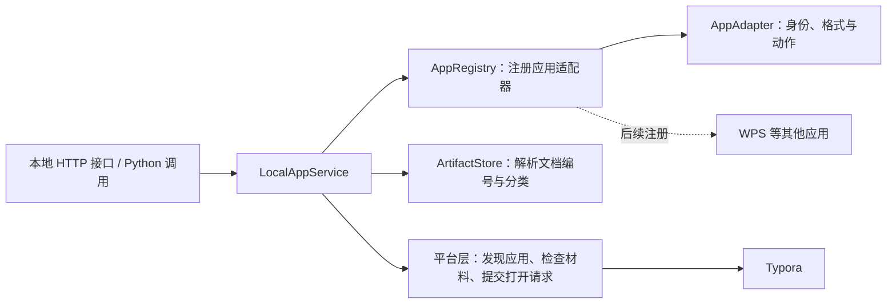

# 本地应用适配层

更新：2026-10-15。本轮接入 Typora 底层服务，页面和主 Agent 的对话工具继续使用现有交互。

## 封装结构



- **应用注册层**：声明应用编号、显示名称、bundle 身份、支持的文档格式和操作。
- **服务层**：接收应用编号与内容库文档编号，校验能力及材料；调用平台层并记录结果。
- **文档解析层**：由 `ArtifactStore.resolve_document()` 和 `resolve_directory()` 提供受内容库边界约束的路径；服务不读取正文。
- **平台层**：封装应用发现和启动，当前使用 macOS Launch Services 的 `open`；调用参数使用数组，不经过 shell。后续可单独增加其他平台实现。

各主 Agent、Subagent 和未来页面可以复用同一服务。应用适配器属于工具基础设施，业务 Harness 不需要依赖 Typora 的安装路径或启动命令。

## Typora 首版能力

- 查询是否安装、版本、当前可用操作与文件格式。
- 打开内容库中的 Markdown 或文本文件，保留原文件位置和相对图片路径。
- 打开内容库根目录或已注册分类目录；该能力同时依赖安装应用声明的目录支持。
- 应用未安装、平台不支持、格式不支持、文档不存在或启动失败时返回明确错误。

首版通过 [Typora 官方说明的 macOS 文件打开方式](https://support.typora.io/Use-Typora-From-Shell-or-cmd/)提交文件；目录支持依据 [Typora 文件管理文档](https://support.typora.io/File-Management/)和本机安装包声明。无需本轮新增辅助功能权限。

打开成功返回 `status: submitted`，表示系统接受了请求；应用仍可能弹出许可提示、加载失败或尚未完成显示。服务不据此宣称已阅读、编辑或导出文档。超时结果带 `may_have_submitted: true`，调用方应先检查应用实际状态，避免自动重复启动。

## 底层 API

| 方法 | 路径 | 请求 |
| --- | --- | --- |
| GET | `/api/local-apps` | 返回注册应用与可用状态 |
| GET | `/api/local-apps/typora` | 返回 Typora 状态 |
| POST | `/api/local-apps/typora/open-document` | `{"artifact_id":"内容库文档编号"}` |
| POST | `/api/local-apps/typora/open-directory` | `{"category":"paper_summary"}`；省略分类则打开内容库根目录 |

文档编号可从已有 `/api/artifacts` 列表获得。打开操作复用服务现有的本机来源检查、`X-Agent-Token` 和 JSON 校验；未知参数拒绝。客户端不传绝对文件路径、可执行程序或额外启动参数。

POST 接受请求时返回 HTTP 202；失败返回 `error/code/may_have_submitted`。普通文档解析错误沿用已有内容库错误格式。密钥不传给应用，日志只记录应用、操作、文档编号／分类和结果。

Python 调用接口：

```python
from artifacts import ArtifactStore
from local_apps import LocalAppService

library = ArtifactStore(settings.output_dir, settings.database_path, settings.data_home)
apps = LocalAppService(library, logger=logger)
metadata = apps.list()
status = apps.status("typora")
# 以下调用会实际启动应用，应由明确的用户操作触发。
result = apps.open_document("typora", artifact_id)
```

## 增加 WPS 等应用

通过 `AppRegistry.register()` 注册新的 `AppAdapter`，声明真实应用身份、允许的格式与支持动作，复用 `LocalAppService` 和平台层。注册在服务启动阶段完成，之后重启本地服务。

这只增加应用能力，不会自动转换文件格式。WPS 的 DOCX、XLSX 等文档还需要内容库提供相应格式的目录、编号和安全解析，或注入兼容的文档解析服务。复杂的编辑、导出或界面操作应放入该应用自己的适配器，继续使用共享接口。

## 当前边界

- 目前只注册 Typora，WPS 保留扩展接口。
- 当前平台实现为 macOS，其他系统明确返回不支持。
- 首版不提供 GUI 点击、输入、自动编辑、导出 PDF 或应用内状态读取。
- 本轮没有新增对话指令、页面按钮、自动打开规则或新定时能力。
- 本轮未运行自动测试，也未实际打开用户文档；完成语法检查与安装元数据核对。
