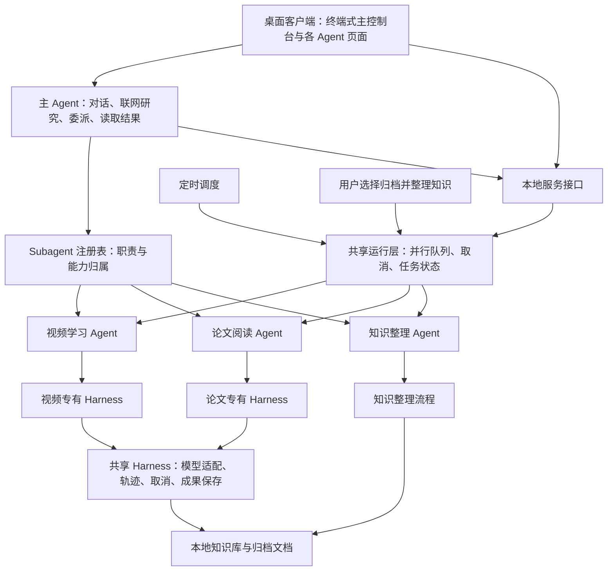

# Agent 工作台：模块封装与扩展框架

更新：2026-10-15。本文描述当前实现；后续方向单独标明。

## 1. 组织方式

以 Agent 的职责组织系统。每个 Subagent 拥有自己的能力集合、模型配置和 Skills；一个 Subagent 可以拥有多项能力，同一个 Subagent 可以执行多个独立任务实例。



普通对话与 Web research 由主 Agent 完成。知识整理只在用户选择归档并整理知识时触发；其页面用于独立配置和查看整理任务，目前没有通用的自主工具循环。

## 2. 模块边界

| 模块 | 封装的职责 | 对外接口 | 扩展时修改的位置 |
| --- | --- | --- | --- |
| `agent_registry.py` | Agent 身份、职责、能力归属、默认 Skills、页面元信息；注册项不可直接修改 | `register/get/owner/all/add_operation`、`Subagent.metadata()` | 注册新 Agent，或为已有 Agent 添加能力 |
| `conversation.py` | 主 Agent 历史与模型循环、联网查询、委派和结果读取 | `list_subagents/delegate_subagents/read_subagent_results` 等模型工具 | 增加主 Agent 工具或协调策略 |
| `capabilities.py` | 工作流的输入 schema、领域校验、执行器和统一输出 | `CapabilityRegistry.register/validate_parameters/execute_capability` | 新工作流模块与输入输出契约 |
| `subagents.py` | 为每次委派建立隔离历史，驱动有轮数和时间限制的工具循环 | `run_business_subagent` | 进一步增强循环和终止策略 |
| `harness.py`、`harness_runtime.py` | 模型通信、执行快照、取消、进度、轨迹与成果文件 | `Settings`、`SharedHarness` | 通用运行保障 |
| `business_harnesses.py` | 领域工具、材料处理、成果检查和业务预算 | `BusinessHarness` 子类、`register_business_harness` | 新领域处理逻辑或工具 |
| `runtime_pool.py` | 有并发上限的执行队列 | `submit/status/shutdown/join` | 调整并发上限；未来换进程执行后端 |
| `web_server.py`、`scheduler.py` | 即时任务与定时任务生命周期、批量委派、恢复与通知 | 本地 HTTP API、`UITaskStore`、`Scheduler` | 新触发方式与任务管理 API |
| `agent_profiles.py` | 独立 API/模型/Skills、逐字段继承、私有覆盖与脱敏 | `AgentProfiles`、`resolve_agent`、`create_client` | 新厂商适配器或配置项 |
| `knowledge.py`、`knowledge_context.py` | 知识提取、来源、入库、检索及对话上下文预算 | 知识服务与检索接口 | 语义检索或新的知识处理策略 |
| `storage_layout.py`、`artifacts.py` | 分类文件目录、自动保存、迁移、查询、回收与恢复 | 目录与成果管理接口 | 新成果类型与分类策略 |
| `web/agent_console.js`、`web/app.js` | 终端式连续输出、任务进度、Agent 页面与路由 | `/api/subagents` 等本地接口 | 通用页面模板或领域专属输入组件 |

模块应通过公开接口调用。注册表负责声明归属，运行队列负责执行，页面只读取元信息和调用服务接口。

## 3. 当前 Agent

| Agent ID | 职责 | 当前能力 | 配置及页面 |
| --- | --- | --- | --- |
| `video_learning` | 视频知识学习 | `video_summary` | 独立 API/模型/Skills、视频材料输入、任务列表与成果 |
| `paper_reading` | 阅读研究论文 | `paper_summary` | 独立 API/模型/Skills、链接/原文/PDF、任务列表与成果 |
| `knowledge_archivist` | 整理归档对话中的知识 | `conversation_knowledge` | 独立 API/模型/Skills、知识整理步骤及任务列表；由归档触发 |

历史角色 `video_summary/paper_summary/conversation_knowledge` 作为配置别名继续读取；用户保存新配置时使用 Agent ID。既有记录与私有规则目录保留。

## 4. 增加能力与增加 Agent

### 为已有论文阅读 Agent 增加“多篇比较”

1. 在独立模块实现比较工作流，定义参数 schema 与结果格式。
2. 实现 `BusinessHarness` 子类，管理比较步骤和成果检查。
3. 注册 `Capability`，再调用 `register_business_harness("paper_compare", CompareHarness, "paper_reading")`。
4. 主 Agent 从注册表发现新能力；定时调度复用同一能力接口。论文页面自动显示其能力归属。若需要专门的多文件输入组件，再扩展该页面。

论文 Agent 的身份、API/模型/Skills 和页面保持为同一个对象。比较任务仍有自己的运行历史、取消令牌与成果文件。

### 增加新 Agent

先注册工作流，再用 `registry.register(Subagent(...))` 声明职责、能力与 Harness 工厂、默认 Skills。页面未指定时使用 `agent_<id>`，客户端自动建立基础页面：职责、能力、工具、配置入口、任务记录和主控制台入口。

基础模板不自动提供所有领域的专属输入组件。通用对话委派与定时 schema 已能复用；复杂材料选择器需要单独提供 UI 组件。

扩展注册发生在服务启动阶段，完成后重启服务。当前没有动态加载第三方插件的安装管理器。

## 5. 并行流程

1. 主 Agent 用 `list_subagents` 查询职责与能力。
2. 将相互独立的任务一次提交给 `delegate_subagents`，每批 1–8 项。
3. 服务校验 Agent 归属与输入，为各任务生成独立 ID，并记录同一批次 ID。
4. 即时任务、定时任务和知识整理共用执行池，默认最多同时执行 4 项。
5. 每项任务冻结 API/模型/Skills，使用独立历史、取消控制、轨迹和成果路径。
6. 主 Agent 可以通过 `read_subagent_results` 读取当前对话的真实结果后综合回答；页面持续显示各任务和批次进度。

长任务完成后，成果与错误分别返回发起对话。目前不会因整个批次完成而自动再次调用主模型生成综合报告；用户继续对话即可要求比较和汇总。

可用环境变量调整上限：

```bash
MINIMAL_AGENT_MAX_PARALLEL=4 .venv/bin/python agent.py web
```

支持 1–16。同一 Agent 的多项任务可以并行；本地 ASR 另设单实例资源限制，以避免同时转录耗尽内存。存在数据依赖的任务应等待前置结果再提交。

## 6. 数据与当前边界

- 成果按能力分目录，知识归档单独保存；一次知识整理归档生成一份包含所有知识点的文档。
- SQL 记录任务、会话、定时计划及来源；配置、密钥、账号会话与文件保存在本机。
- Subagent 的隔离范围是同进程中的历史、配置、工具和任务状态；没有进程沙箱。
- 执行池的并发上限约束整个任务；目前没有按模型供应商细分的限流器或费用预算。
- 专有 Harness 当前使用 `produce_result/inspect_result/finish_task` 驱动较完整的领域工作流。更细的“获取材料、分析、比较”等工具以及跨任务依赖图，是下一步可独立增强的接口。
- 主 Agent 有轮数与时间守门条件；此实现不是无限重启的 Ralph loop。
- 本轮未执行真实模型并行验收。语法检查与页面启动不构成端到端任务通过的证明。
