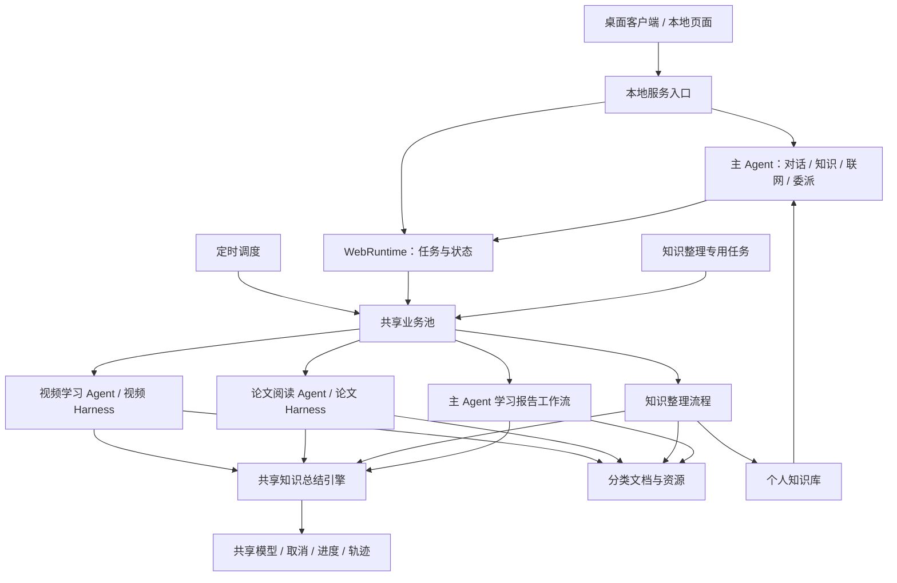

# Agent 工作台架构框架

更新：2026-10-30。本文是当前设计的简明入口。完整数据流、状态、接口、存储、预算和重构候选见 [设计文档](设计文档.md)；产品范围与验收条件见 [需求文档](需求文档.md)。旧版框架保留在 [历史记录](docs/history/架构框架-2026-10-24.md)。

## 1. 整体关系

图表示职责关系。共享 Harness 是每次运行的服务视图，队列/调度由运行层管理。主 Agent 对话另有线程；知识整理在桌面/Web 内注入共享业务池，但没有通过 CapabilityRegistry 执行。

## 2. 角色和工作流

| 所有者 | 现有操作 | 当前实现 |
| --- | --- | --- |
| 主 Agent | 对话、联网研究、资料管理、Study Log 读取 | 直接工具循环；研究不单列业务 |
| 主 Agent | study_report | 主 Agent 所有的后台 Capability，支持即时/定时 |
| video_learning | video_summary | 可委派 Subagent + VideoHarness |
| paper_reading | paper_summary | 可委派 Subagent + PaperHarness |
| knowledge_archivist | conversation_knowledge | 专用知识整理服务，delegatable=False，非 Capability |

一个 Subagent 可以拥有多项操作，不按每个功能建立角色。公共总结是服务；网站读取、应用适配和模型通信也不需要各自成为 Subagent。

## 3. 模块边界

| 边界 | 主要文件 |
| --- | --- |
| 交互与入口 | web/、desktop/、agent.py、web_server.py |
| 主 Agent 和知识上下文 | conversation.py、knowledge_context.py |
| 职责与能力合同 | agent_registry.py、capabilities.py、tool_registry.py |
| 业务循环与专有 Harness | subagents.py、business_harnesses.py |
| 共享执行保障 | harness.py、harness_runtime.py、runtime_control.py、model_transport.py |
| 配置与规则 | agent_profiles.py、skills/ |
| 队列与计划 | runtime_pool.py、scheduler.py |
| 原材料与公共总结 | video_summary.py、paper_summary.py、share_links.py、summary_engine.py |
| 知识持久化 | knowledge.py |
| 文档及资源 | storage_layout.py、artifacts.py、report_exports.py |
| 外部服务与 App | study_log.py、study_report.py、site_sessions.py、local_apps.py |

公共知识合同为 `SourceBlock → SummaryBundle → 领域成稿`；来源位置由读取器建立，模型不创建权威页码或消息编号。

## 4. 扩展性与当前边界

- 新职责注册 Subagent；已有职责增加操作；主 Agent 封装工作流可显式指定 settings_role。
- 新材料适配为 SourceBlock，复用整合核心；领域输出保留自己的范围与证据规则。
- 现有模型调用入口使用 ModelClient 协议和 create_client 工厂；生产厂商目前只有 DeepSeek，新增厂商仍需适配与联调。
- 新本地应用可登记 AppAdapter。Typora 目前是底层服务/API，对话和页面入口未接入；WPS 未实现。
- 即时、定时、Web 知识任务默认共用 4 个业务槽，主对话另计；同进程隔离不等于系统沙箱。
- 注册在启动时完成，没有动态插件系统；框架有接口不等于所有新能力自动拥有完整 UI。
- 完成文件/来源检查不等于内容真实核验；当前不是 Ralph Loop，也没有统一全局费用预算或自动断点恢复。

## 5. 重构讨论入口

[设计文档第 14 节](设计文档.md#14-重构候选尚未实施) 汇总目前耦合、状态与运行语义的问题，并给出分段替换建议；尚未修改业务实现。

[课程设计思想](docs/课程设计思想.md) 是持续更新的参考，已纳入需求：意图与规格追踪、状态所有权、公共契约、可检查循环、事实与投影、渐进演化。它不构成改用 dsh、全量插件化或事件溯源的既定决定。
