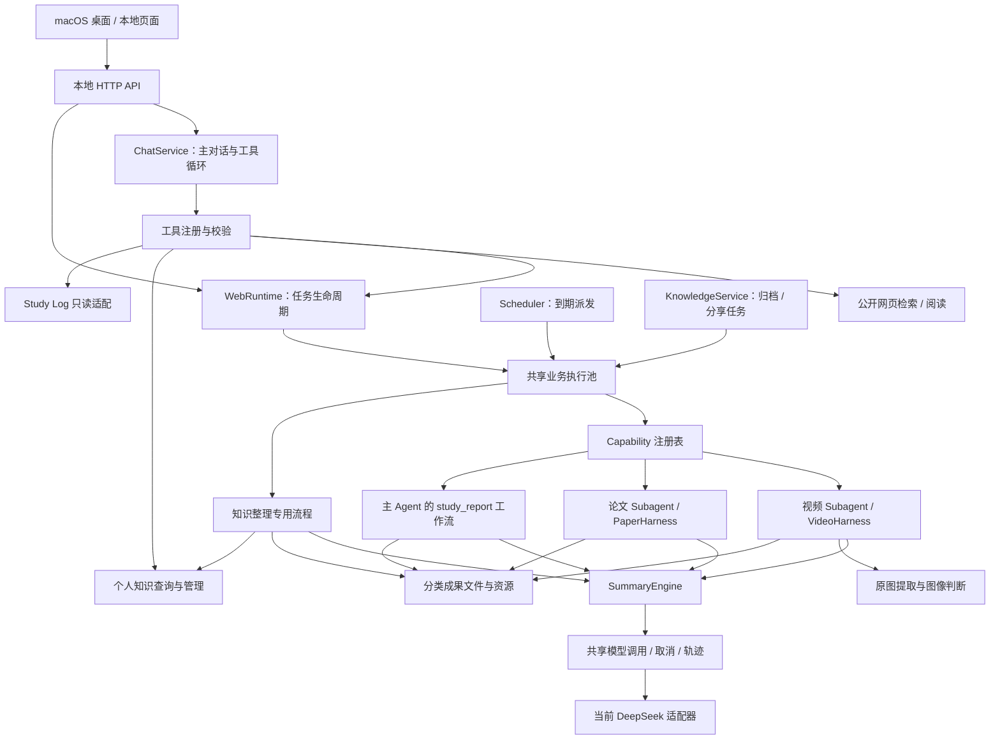
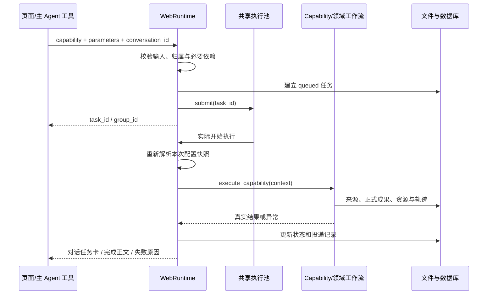
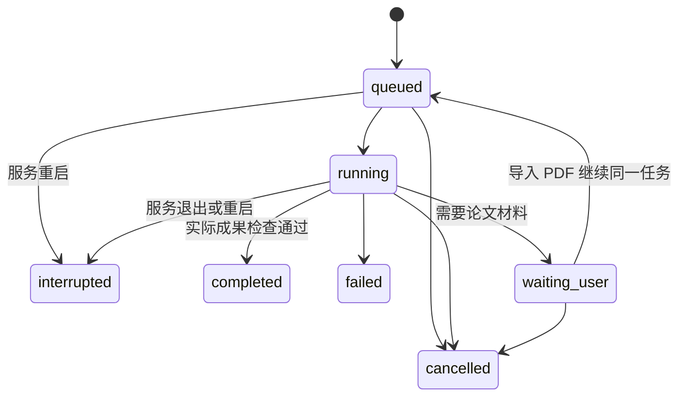

# Agent 工作台设计文档

基线日期：2026-10-29；实施更新：2026-11-07。范围：当前实现、接口与状态语义，以及尚未实施的重构候选。

需求来源：[需求文档](需求文档.md)。设计参考：[课程设计思想 P01–P12](docs/课程设计思想.md)。初始基线基于源码阅读；后续测试和联调证据见 [实施与验收记录](docs/实施与验收记录.md)。

## 1. 系统边界与术语

系统是单用户、本机运行的 Python 后端与 macOS 桌面工作台。AppKit/WKWebView 和普通浏览器使用同一本地 HTTP API。模型服务、公开视频平台、论文网站、公开分享与 Study Log 是外部依赖；Typora 是本地外部应用。

| 对象 | 当前责任 | 不负责什么 |
| --- | --- | --- |
| 主 Agent / `ChatService` | 普通对话、上下文组装、工具循环、委派、成果读取与会话管理 | 不直接实现视频下载、PDF 提取或 ASR |
| `Subagent` | 职责、能力归属、默认规则、页面与配置角色 | 不等于一次任务，也不是 OS 进程 |
| `Capability` | 输入合同、领域校验与执行入口，统一即时/定时调用 | 不要求每项都归 Subagent |
| `ToolRegistry` | 模型工具说明、参数校验和执行器注册 | `effect` 标记还不是通用权限审批系统 |
| `SharedHarness` | 单次模型/取消/进度/轨迹/文件服务视图 | 不拥有队列、调度器和全部数据库事务 |
| `BusinessHarness` | 领域工具、预算、执行和完成检查 | 不提供无限自主规划任意工具链的保证 |
| `SummaryEngine` | 从来源文字提取并整合知识 | 不获取原材料、不识别图片、不自动入库 |
| 任务 / 运行实例 | 某次提交的状态和执行结果 | 与角色、定时计划、成果文件身份不同 |

## 2. 当前架构



图中为职责关系，非精确调用栈。知识整理有独立任务表与提交逻辑；在 WebRuntime 内注入共享执行池后使用相同工作槽，并非通过 Capability 执行。主对话另开线程，不占业务池槽位。

### 2.1 已注册对象

| Agent / 所有者 | 能力或操作 | 执行形态 | 页面 |
| --- | --- | --- | --- |
| `video_learning` | `video_summary` | 可委派 Capability + `VideoHarness` | `video` |
| `paper_reading` | `paper_summary` | 可委派 Capability + `PaperHarness` | `paper` |
| `knowledge_archivist` | `conversation_knowledge` | `delegatable=False`，`KnowledgeService`；不是 Capability | `archivist` |
| 主 Agent `conversation` | `study_report` | 主 Agent 所有的 Capability | 设置连接、对话、通用成果与调度页面 |
| 主 Agent | 对话、网页研究、内容/知识工具 | 普通工具 | `chat` 等管理页面 |

当前 CapabilityRegistry 只有 `video_summary`、`paper_summary`、`study_report`。Web research 没有独立 Capability；`web_research/` 目录用于历史兼容。

### 2.2 模块所有权

| 模块 | 当前封装内容 |
| --- | --- |
| `agent.py` | CLI、旧交互循环、配置命令、功能/调度/服务命令 |
| `web_server.py` | HTTP、WebRuntime、即时任务存储、委派、恢复、调度桥接、成果投递 |
| `conversation.py` | 会话持久化、主循环、工具组装与路由、知识上下文、任务投递 |
| `agent_registry.py` | Subagent 身份、操作归属、页面和兼容角色 |
| `capabilities.py` | Schema 子集校验、能力注册、配置角色、目录作用域和执行合同 |
| `subagents.py` / `business_harnesses.py` | 业务 Agent Loop、领域工作流及成果检查 |
| `harness.py` | 基础配置、Skills、DeepSeek 客户端、日志、通知、JobStore |
| `harness_runtime.py` / `runtime_control.py` | 受控模型、取消令牌、轨迹、进度、原子文件保存 |
| `model_client.py` | 厂商无关的 ModelClient 协议（普通、流式与 JSON 调用） |
| `model_transport.py` | 固定模型地址、TLS、建连恢复、超时和中断阶段 |
| `agent_profiles.py` | 逐角色配置、继承、私有规则和厂商工厂 |
| `runtime_pool.py` / `scheduler.py` | 工作池、到期调度、调度租约、跳过策略、launchd |
| `summary_engine.py` | 公共知识中间表示、分块提取、合并、来源和预算检查 |
| `video_summary.py` / `paper_summary.py` | 领域材料读取、模型成稿与来源说明 |
| `knowledge.py` / `knowledge_context.py` | 知识提取任务、索引/版本/来源、主会话检索 |
| `share_links.py` / `web_research.py` | 公开分享解析、公开网络访问、搜索与静态正文 |
| `storage_layout.py` / `artifacts.py` / `report_exports.py` | 目录、迁移、文档查询/回收/恢复、资源打包 |
| `site_sessions.py` / `desktop/AccountBrowser.swift` | 网站会话元数据、专用登录窗口、PDF 导入 |
| `study_log.py` / `study_report.py` | 只读配对与查询、完整分页统计、复盘成稿 |
| `local_apps.py` | App 注册、格式/动作、内容编号解析与平台打开请求 |
| `web/` / `desktop/AgentDesktop.swift` | 页面状态与呈现、原生窗口及后端生命周期 |

这些是现有文件职责，尚未全部收敛为理想分层。具体耦合与候选方案见第 14 节。

## 3. 公共接口与中间表示

### 3.1 Capability 合同

```text
Capability
  id, title, description
  input_schema
  validator(parameters) -> normalized parameters   # 可选
  executor(parameters, context) -> result
  settings_role                                  # 可选，仅 global/conversation

CapabilityContext
  settings, logger, client, progress, output_path, cancellation

Result（当前通用约定，尚无统一强类型）
  capability, title, path
  markdown 或 text
  领域扩展字段：sources/material/sections/frames/statistics/summary_processing 等
```

输入只支持项目使用的 JSON Schema 子集：类型、必填、默认值、枚举、长度、范围、数组和闭合对象；`format` 的领域含义由相应校验器处理。不能声称支持完整 JSON Schema 标准。

执行时先校验参数与取消状态，再解析所有者配置，将输出目录限定到能力分类。未返回路径但有有效正文时，能力层可兜底保存文件。业务完整性仍由专有检查或工作流负责；`execute_capability` 本身不证明知识正确。

`settings_role` 指定的主 Agent 工作流在元数据中为 `owner_type="main"`、`agent_id=null`。未指定者通过 SubagentRegistry 查所有者。当前任务表的 `agent_id` 对主工作流记录 `conversation`，因此该字段实际混用了角色语义，后续宜拆分。

### 3.2 来源与知识合同

```text
SourceBlock
  id: 本次材料内唯一、由程序生成
  text: 实际取得的文字
  locator: 领域定位信息（JSON 对象）

SummaryBundle
  overview
  units: 整合后的知识单元（标识、标题、正文、标签、source_ids）
  sources: 已提供的来源与定位
  processing: 本次处理规模、分块/合并/调用等信息
```

| 材料 | 来源建立者 | locator 的含义 |
| --- | --- | --- |
| 视频 | 字幕/ASR 读取与分段程序 | 文字稿时间范围，用于画面定位，正文不必显示 |
| 论文 | PDF/网页/原文读取器 | PDF 真实页码；其他文字为单一来源块，保留材料类型和可用 URL/文件名，无段落偏移 |
| 对话 | 本地快照或公开分享解析器 | 消息编号和角色；分享链接、读取范围另存于材料级元数据 |
| Study Log | 只读记录适配及报告程序 | 记录 ID、日期、项目 |

模型不得创造权威定位信息。领域成稿回报使用的知识单元 ID，程序校验覆盖声明；这只是结构合同，不是独立语义核验。

### 3.3 Tool 与模型接口

Tool 包含名称、说明、参数 Schema、执行器与 `effect`。SharedHarness 调用 ToolRegistry 校验并执行。当前 `effect` 没有连接统一授权策略执行器。

模型接口提供 `chat`、`stream_chat`、`json_chat`；ControlledModel 注入取消。主对话、业务角色及 CLI 经 `create_client` 创建适配器，显式注入的客户端会被保留。当前生产适配器只有 DeepSeek。

## 4. 运行流程与完成语义

### 4.1 主 Agent 回合

1. 锁定本会话活动回合，解析配置、取消令牌与本次联网开关。
2. 组装系统规则、时间信息、Skills、相关个人知识、近期历史及当前会话后台任务状态。
3. 请求模型；收集流式正文、工具请求和厂商所需推理字段。
4. 有工具请求：校验参数、逐项执行、持久化结果后进入下一轮；工具实际失败同样成为观察。
5. 无工具请求：结束本轮文本回复。普通主回复结束不等于后台任务完成。
6. 轮数/时间耗尽、连接中断或取消：保存已收到的正文并标明状态。若流在结束标记前断开，提示请求已经发送、可手动重试。手动重试会替换失败回复，并沿用原问题和已确认的工具结果。

历史按完整用户回合裁剪，避免拆开工具请求和回复。当前最多保留 12 个用户回合，另有约 11 万字符历史预算；这不是通用自动语义压缩。

主 Agent 每回合最多 8 轮、约 480 秒，每次模型请求上限按剩余时间收敛到最多 90 秒；每轮工具请求有限制。内部网络及工具各有自己的边界，不能把外层预算解释为所有操作都被精确硬中断。

联网由 WebSources 提供搜索与静态正文读取。搜索可限定 `site` 和 `required_terms`。工作台核对候选网址的域名和标题、摘要、路径中的术语，在限制数量前筛掉未命中项。`provider=auto` 在 Bing 失败或无匹配时尝试 DuckDuckGo。单独指定通道时只访问该通道。通道错误与无匹配分别记录。搜索摘要是线索，正文实际读取量和访问失败单独记录。

正文失败按请求网址及字符起点记录，忽略网址片段；成功读取同一起点才清除对应失败。不同起点的续读错误可以与已读区间并存。主对话重试从工具记录恢复区间和续读失败，来源卡分别展示搜索线索、正文范围、续读失败及其他网页读取失败。

网页读取保留每次最多 24,000 字符的边界，支持 `start_char` 指定起点，返回左闭右开的 `start_char/end_char` 和后续起点 `next_start`。来源记录合并相同正文版本的已读区间，重叠部分不重复计数；正文指纹变化时重新计算覆盖范围。对话重试按原工具结果顺序恢复这些区间，兼容没有区间字段的旧结果。读到全文末尾只表示本次节选已到末尾，只有累计区间覆盖整个可提取正文才记为完整读取。

HTML 读取还返回最多 80 条导航链接。优先提取 main、article 或 role=main 区域中的链接，相对地址基于重定向后的实际页面解析，仅保留 HTTP/HTTPS 地址，并排除脚本和嵌入凭证的链接。链接是未读线索，只有后续实际读取后才进入已读来源记录；继续访问仍经过已有网络地址校验。

对话重试从已保存的工具结果恢复实际搜索尝试、正文区间与失败记录。含页内片段的地址统一按实际网页处理。工具重复请求使用缓存前仍须通过本轮工具注册检查；关闭联网后，既有历史可继续提供背景，本轮不调度联网工具，也不返回缓存作为新的工具调用结果。

### 4.2 即时任务、委派与回传

即时任务与批量委派共用能力归属和参数校验。批量委派在一个 SQLite 事务写入全部任务及批次关系，提交后在同一执行器锁内入队。写入失败回滚整批，执行器拒绝时统一记录提交失败。成功入队后各任务独立完成、失败或取消。

任务回传的 Markdown 附带来源文件提示，前端以成果路径作为相对链接和图片的解析基准。旧回传可从关联任务查询当前输出路径，避免将附件解析到网站根目录。来源提示仅对任务回传提供，普通回复继续使用原有解析方式。

任务完成时若原会话正在回复，后台先保存结果。回复结束后按原会话查找待投递任务，服务启动时补查全部未投递结果。回传按任务、尝试次数和状态去重，独立于全局最近任务列表。任务卡片保留投递时的状态，供较旧记录显示。



一批委派先校验各项再创建；中途提交失败尝试取消已提交项，但不提供跨任务原子事务。`group_id` 用于聚合，不表达依赖图。

### 4.3 业务 Subagent Loop

视频/论文使用自己的消息列表及三个工具：

```text
produce_result -> inspect_result -> finish_task
```

- `produce_result` 内部调用整个既有领域工作流；一次成功后缓存结果。
- `inspect_result` 验证成果并返回正文摘录/来源；不是重新完整阅读全部内容。
- `finish_task` 要求先检查，再重复核验文件和业务约束。
- 未调用完成工具，仅说“完成”不能使任务通过。
- 最多 5 轮；视频 4500 秒、论文 2400 秒的外层预算，在轮次和工具边界检查。

SharedHarness 检查文件在允许目录、存在、非空、大小不超限，磁盘正文与结果一致。视频额外核对图片；论文额外核对材料与阅读范围。返回的 `verified` 是这些检查通过，不是事实认证。

### 4.4 当前任务状态



这张图概括 Web 业务任务的主要路径，不表示所有存储使用同一个状态机。内容删除还会隐藏正文/链接或表现为 deleted；知识整理使用独立 ingestion 状态；聊天有 stopping；定时运行另有 missed。

当前不支持暂停后原执行栈恢复；重启中断不是检查点续跑。重试前必须区分已完成动作、明确失败动作与结果未知动作。

## 5. 共享知识总结与领域处理

### 5.1 公共总结流程


提取阶段保留条件、否定、数字与依据；合并阶段校验来源 ID 与输入笔记覆盖声明，并按每条输入笔记检查来源保全。一条多页笔记可拆成分别引用相关页的子主题，这些输出合计必须保留该笔记全部来源；仅在其他笔记中出现同一页不足以通过检查。短材料同样经过整合。超量、格式错误、不收敛或引用失效明确失败，不静默截断以宣称成功。

整合后的知识再与读取器的原始文字对照。默认使用原提取块范围与引用来源的交集选择待核对知识，每批序列化输入最多 64,000 字符。模型可以修订概述和正文，程序保留知识编号、现有来源及读取器记录的位置、角色和范围。复核调用计入原有总调用上限，遇到无支持条目、非法响应、超量或取消时停止。`source_review_batches` 和 `reviewed_units` 记录处理范围。

论文启用全文复核。完整材料与单条知识能放入同一批时，每批都带上完整材料，知识条目按预算分批。较长材料沿用原始文字窗口。缺少跨页引用时，模型可以提出该批已见来源及对应短引。程序核对短引出现在该来源文字中，保留原有来源并补充新来源。核对范围写入 `source_review_scope`，新增短引随知识条目进入依据附件。

图像判断在视频专属步骤执行，知识入库在 KnowledgeService 执行；SummaryEngine 不承担这两项职责。

### 5.2 视频

`游客链接校验 → yt-dlp 元数据与字幕 → 必要时音频/本地 ASR → 时间范围来源块 → 公共总结 → 知识章节 → 候选画面 → 下载视频/FFmpeg → 逐图观察 → 章节相关性核对 → Markdown + 原图`。

- 忽略用户 yt-dlp 全局配置，不读播放列表或登录 Cookie；排除弹幕、直播聊天作为字幕正文。
- VTT/SRT 读取器按字幕块识别首行或编号之后的时码，跳过无有效时码的元数据及 WebVTT 注释。仅清理已知格式标签和行内时码，正文里的格式关键词和比较符号进入来源块。 [WebVTT 规范](https://www.w3.org/TR/webvtt1/#webvtt-file-structure)
- B 站链接显式指定 `p` 时，元数据须与所选分集一致，并提供待读取的受支持字幕轨道或媒体格式。验证后的分集链接写入正文，原始链接、实际分集链接及平台媒体标识写入依据附件。
- ASR 使用本地 faster-whisper、默认 base、CPU int8/VAD；单 ASR 信号量限制内存竞争。
- 原图候选受章节实际来源区间约束；每章最多 2 张，全片最多 8 张，相关性判断使用该业务当前同一个模型客户端。
- 逐图观察只输入单张原图，以高精度读取可辨的公式、节点和箭头。节点图检查贴近边框的箭头尖和图外进入节点的短箭头，方向无法确认时只保留可辨的连接。单张图片的模型回复格式无效时记录并跳过该帧。相关性核对再读取其余观察说明、字幕和章节草稿并按编号选图。图注沿用观察说明，实质冲突提示的两段引文分别核对是否出现在章节草稿和该图的观察说明中。 [DeepSeek 图像输入](https://api-docs.deepseek.com/guides/vision/)
- 模型可提交局部节点图的坐标和整图可辨标签。整图说明未给出箭头方向时，工作台检查区域边界和大小，从同一原帧裁取局部、留出边缘并放大后复核。每个视频最多发起两次局部复核。只有起止标签符合整图观察的箭头才可添加到图注，图外入口允许无起点标签。整图说明保留，合并后的图注仍需通过章节相关性判断。文档和导出始终引用整张原帧。
- 未配置独立视觉厂商/模型；模型不支持图像或媒体步骤失败时可退回纯文本。
- 字幕和音频均无可用材料时失败，不按标题推断内容；临时媒体清理，选中原图持久保存。
- 模型编排章节标题、知识条目顺序、图示与候选帧。程序按该顺序拼接已对照原文的知识正文，开头概述也取自共享总结的复核结果。
- 视频报告注明文字来源和画面处理范围，并链接 `*_assets/source-evidence.json`。依据文件保留字幕或转录片段、知识条目、章节与来源编号、内部定位及取帧计数。原图与依据链接使用编码后的相对路径，随 Markdown ZIP 导出。画面说明作为普通文字写入，避免示例里的图片标记被误解析。

持续变化的外部 video2text 引擎仍属 FR-07a 候选。拟通过独立进程和固定版本的适配器消费转录与质量结果，再转换为现有来源块；不直接依赖其内部流水线或让外仓笔记替代共享总结。版本快照、真实格式差异及升级/回退方案见 [video2text 适配设计](docs/video2text适配设计.md)。

### 5.3 论文与账号辅助

`输入三选一 → 读取实际 PDF/HTML/原文 → 足量文字及范围检查 → PDF 按页、其他文字单一来源块 → 公共总结 → 论文成稿 → 来源/范围说明 → Markdown（取得 PDF 时附 original.pdf）`。

论文同时在 `*_assets/source-evidence.json` 保存实际提取的来源块、读取器给出的页码或链接位置、整合知识条目及来源编号关系。正文附该文件链接，ZIP 导出携带该固定附件；完成检查确认附件存在。来源块保留输入文字，属于本地成果材料，遵循内容库资源的删除和恢复流程。已有成果继续按原格式读取，旧成果的中间依据无法追溯补造。附件支持人工核查，来源编号与结构检查不保证成稿语义正确。

论文成稿直接按主题编排已复核的知识条目，保留条目中的限定词、条件和反例。程序给每个条目添加依据，并根据读取器位置映射生成“依据 k1，PDF 第 … 页”。覆盖检查忽略代码示例、转义字面量和 HTML 注释中的标记。页码采用本次输入 PDF 的物理页序，输入为截取 PDF 时也是截取文件内的页序。事实检查仍需对照实际原文。

arXiv 摘要链接尝试 PDF，页面可发现公开 PDF 元信息。失败时使用实际取得文字并声明范围。Researchr 会议详情页读取唯一可确认的摘要字段，并将材料类型记录为 `abstract`。PDF 读取器记录物理页数、可用文字页和排除的页。扫描 PDF 的内嵌文字过少或多为短字符碎片时，保留实际页码和原文件，并从总结依据中排除该页。表头与数字行位置清晰的简单表格额外提供列提示，保留空格。检测到数值落在两个重复列之间时，保留原值并标明单列归属未确定。无法可靠对齐的行或整表沿用原始提取文字。视觉图表、复杂公式与 OCR 仍有读取限制。

读取器检查 PDF 页面调用的嵌入表单内容流（Form XObject），同时识别其中使用不可见渲染模式的文字。发现嵌入文字时尝试内容流顺序提取，并在确有更多可提取字符时采用。成稿附录单独列出采用该方式的物理页和未能补读的页。按内容流顺序提取的来源块带 `text_order=content_stream`，不生成表格列对齐提示，碎片排除规则仍适用。 [Adobe PDF 参考](https://opensource.adobe.com/dc-acrobat-sdk-docs/pdfstandards/pdfreference1.3.pdf)

WebRuntime 对 IEEE 链接直接进入材料辅助。用户打开独立 WebKit 会话登录，下载或导入 PDF；arXiv/OpenReview 可主动点击发现 PDF。导入为有效上传材料后，保留同一任务 ID 重新排队。

网站会话状态包括 needs_login、session_saved、material_imported、access_failed、clear_pending、cleared。session_saved 只是浏览器状态报告，账号和全文权限仍由网站判断。材料导入与会话清除串行处理。后端在任务接收 PDF 后才标记 material_imported 并绑定任务；浏览器随后上报的登录状态不能覆盖导入结果。原任务在允许继续时可重开。清除完成后绑定新的会话编号，并发请求复用同一新会话；定时任务保留原执行编号。旧会话保持清除，随后到达的 PDF 由导入接口拒绝。普通网页搜索不使用这些会话。

#### FR-08a 论文组会 PPT 的接入设计

2026-11-18 新增需求。PPT 作为 `paper_summary` 的可选关联成果，沿用论文阅读 Agent、执行池、取消与配置。内容顺序及必要性以需求文档 FR-08a 为主定义。

论文 Capability 增加启用、时长和语言参数，领域页面提供可选表单，模型委派及定时表单沿用同一参数定义。原任务补充 PDF 时保留选择。报告 ZIP、离线 HTML 和内容库支持关联的 PPTX 和编排文件。

流程分成三个职责。论文读取与共享总结提供原文块、知识条目及原件。汇报编排根据这些依据生成幻灯片计划，记录各页涵盖的主题、知识编号、物理页码、文字与图表位置。文档渲染把经过校验的计划写为可编辑 PPTX，并保存计划与图表资源，供复查和重新排版。由 PaperHarness 组合这些阶段并检查所选成果。

幻灯片计划须覆盖 Title、Background、Problem Definition、Existing Limitations、Motivation、Contributions、Overview、Experimental Setup、Main Results 和 Conclusion。可在同页覆盖相关主题，方法模块数量取自原材料。条件性主题缺少证据时不生成对应结果页。演示时间影响内容压缩和页数安排，计划及成品均须保留来源和实际读取范围。

图表提取保留物理页码和图表区域。唯一的实际图注可定位图表所在页，图注依据单独保存，不改写论点的来源。模型定位图表后，再检查实际裁剪结果是否完整；通过后才将图片字节嵌入 PPTX。图表提取失败时保留文字页，标明缺失。导出后核对各页的原生文本和已引用图片的字节；仅存于文件包却没有被幻灯片引用的原图不算已交付。原图解读写入讲者备注，来源和未确认的限制保留在编排文件。

首张 Overview 必须提交原图候选、已有方法依据的示意图或材料不足说明。裁剪复核单独判断原图是否为整体架构。核实的原图排在方法细节前，预备示意图不重复展示；原图未确认才使用示意图，两者均无法提供时在页面说明。两种图互为替代，在时长预算中共用一页。

渲染器按可用框大小安排标题、正文和图注；过长的封面资料或正文进入续页，继续保持可编辑。方法示意图按层数选择横向或纵向布局，按同层节点数量留间隔并适配标签。续页计入最终汇报页数；超出时长预算时保留论文笔记并提示 PPT 未完成。

材料类别以读入记录为准。仅摘要时，封面及正文展示未读取全文、图表和附录；缺依据的必需主题在成品中可见。PPT 编排后，含数字的要点按批对照所引用的论文知识，复核数字与模型、实验条件、指标和比较方向是否对应。修正项保留前后文字和可回查的知识引用。复核覆盖不全或修正依据不匹配时，PPT 不标为完成，已存论文笔记可继续使用。

封面作者及出版出处优先使用实际材料中的 PDF 作者字段、首页明确论文集行或网页出版元数据，写入讲者备注与编排文件。预印本编号独立显示，不推断会议；可使用长于普通幻灯片标题的完整题名。

生成的 `presentation.pptx`、幻灯片计划和图表放在论文报告的 `_assets` 目录，报告以编码后的相对链接关联 PPTX。扩展附件读取与导出规则后，内容库删除和恢复继续按整份报告及资源目录处理。选择 PPT 时以报告及演示文件均通过检查作为完整成功条件，错误记录需说明已经保存的材料与未完成的阶段。

验收至少覆盖不选 PPT 的旧参数与历史任务、选择后的普通提交与 PDF 续传、不同汇报时长、必需主题覆盖、条件主题取舍、取消和渲染失败、原图来源、PPTX 可编辑与逐页排版、ZIP 携带以及删除恢复。接入与验收进度见 [实施与验收记录](docs/实施与验收记录.md)。

### 5.4 知识整理与个人知识

本地归档冻结完整有效消息；公开分享校验 URL 后请求游客桌面文档，提取实际公开的单一对话分支，保留角色和顺序。链接预览缺少消息正文时返回错误。分享解析不登录、不执行脚本、不识别图片附件，外链只保留、不自动读取。

结构化数据只有多个候选分支且缺少明确顺序时，直接返回读取错误。使用页面标记作为正文时，消息标签必须完整闭合。页面媒体元素的内容和地址不用于总结；媒体占位保留在归档快照里，提取时从来源块排除，其他消息编号不重新分配。归档附注显示仅含未读取媒体或附件的消息数。

KnowledgeService 自有提交队列和 ingestion 表，在 WebRuntime 内把处理函数提交共享池。需要提取时加载模型配置。共享总结通过结构和来源检查后，先在任务行中保存提取结果和来源快照，再写知识索引及一份归档文档。用户重试时从已保存的结果继续，完成后清除任务行中临时存放的提取结果，正式归档与索引继续保留。

去重采用规范化标题/精确内容指纹，追加来源；相似知识只建立有限相关关系，不进行向量语义合并。编辑有 revision 乐观锁和版本历史。归档 Markdown 是当时快照；索引修改不自动重写文件。

主对话按标题、标签、正文及中文词片段检索当前问题。“继续讲快速排序”“那么快速排序分区呢”一类明确写出主题的消息以该主题检索。仅当整句符合通用追问措辞时，最多回看四条用户消息，找到最近明确主题或遇到显式换题即停止。换题未给出新主题时结束回溯，当前主题查无结果时也结束检索。问候和简短确认不触发检索。追问识别采用有限措辞规则。检索最多 6 条，每条最多 2400 字符和 3 个来源，条目列表序列化不超过 9000 字符。结果以临时引用附在本轮模型请求，系统消息仅包含处理规则，会话数据库保留用户原话。

### 5.5 Study Log

只读适配器固定连接既有 Study Log HTTPS 地址。配对过程：本地创建受限 token → 上传摘要 → 用户网页登录/核对码/授权 → 本地轮询 → 保存有效期与凭证。页面及工具结果不接收完整凭证；网站仅保存摘要。

读取资源仅 records/projects/analytics，拒绝重定向，服务端逐请求核验授权。撤销需服务端确认；网络失败保留本地连接信息重试。此协议是设备配对，不是 OAuth/PKCE。

周报为主 Agent 的 Capability：上海日期解释 → 读取所有记录页与当前项目 → 程序校验/统计 → subject/note 转来源块 → 公共总结 → 复盘报告与记录依据 → `study_report/`。相对周在每次运行时求值，自定义范围固定。

报告直接编排共享总结对照原记录后的概述和知识正文，并生成实际记录编号索引。后续建议独立生成，每条建议关联已复核条目；当前项目状态只作为建议的背景，不能用于补写本期事实。

统计和建议分开；项目当前快照不视为报告期增量。调用模型前，按原偏移量复查全部记录页和项目，任一页的内容指纹变化即停止。接口没有事务快照，读取之间发生并撤回的修改仍可能漏检。零记录报告不调用模型；通用任务入口仍有模型凭证前置检查。

周报从读取开始绑定同一 Study Log 授权。每次向模型提交材料前，Harness 通过同一凭证查询只读连接状态并核对本地凭证仍一致。正式保存前再次核对。复核失败时任务终止，已经发出的模型请求可能仍会返回，旧报告保持可访问。

## 6. 数据、持久化与生命周期

### 6.1 本机布局

```text
数据目录：MINIMAL_AGENT_HOME，默认 ~/.minimal-agent/
  .env                          默认 Key / 模型私有配置
  agent-profiles.json           逐角色覆盖
  skill-overrides/<role>/       用户修改的规则
  harness.sqlite3              会话、执行、计划、投递、知识提取任务
  knowledge.sqlite3            知识条目、来源、版本、批次
  site-sessions.sqlite3        论文网站会话元数据
  connections/study-log.json    Study Log 受限凭证
  uploads/papers/               上传材料及元信息
  subagent-runs/*.jsonl         单次共享 Harness 轨迹
  models/                       本地 ASR 缓存
  trash/notes/<id>/             内容回收站及 manifest
  output-aliases.json           旧输出路径映射
  agent.log                    轮转日志

内容根目录：MINIMAL_AGENT_OUTPUT，默认当前工作目录/summaries/
  video_summary/
  paper_summary/
  knowledge_archives/
  study_report/
  notes/
  web_research/                 历史兼容
  各报告.md + 对应 <stem>_assets/
```

启动脚本可将数据目录设为项目 `.local/`。文档应引用逻辑目录，不依赖某台机器的绝对路径。

### 6.2 主要持久化对象

| 存储 | 表/对象 | 关键含义与关联 |
| --- | --- | --- |
| harness.sqlite3 | conversations / conversation_state | 会话身份、标题、归档时间、当前选中 |
| 同上 | conversation_messages | 按序消息、工具结果、UI actions、消息状态 |
| 同上 | chat_runs / chat_events | 某次回答状态、部分正文、可增量轮询事件 |
| 同上 | ui_tasks | capability、parameters、角色、对话/批次、状态/阶段、成果路径/正文 |
| 同上 | ui_task_profiles | 即时能力任务和论文接续按任务编号及尝试次数记录所加载配置 |
| 同上 | jobs / job_runs | 持久计划与每次到期实例；二者生命周期不同 |
| 同上 | schedule_conversations / task_deliveries | 计划发起会话、任务结果投递去重 |
| 同上 | knowledge_ingestions | 来源快照/指纹、提取状态和完整归档结果 |
| knowledge.sqlite3 | knowledge_entries / knowledge_revisions | 正文、标签、指纹、revision、软删除、历史 |
| 同上 | knowledge_documents / knowledge_sources / knowledge_batches | 原消息快照、知识与来源关联、批次幂等 |
| site-sessions.sqlite3 | site_sessions | 网站、适配器、状态、任务与会话关联；非 Cookie 内容 |
| 文件系统 | Markdown、资源、回收清单 | 正式文档与资产；不由数据库事务单独覆盖 |

Artifact ID 当前由相对路径 SHA256 前 16 位生成，不是稳定全局 UUID。知识 entry ID、文档 ID、上传 ID、任务 ID 是不同身份；重构迁移不能混用。

### 6.3 保存和删除的一致性

- 正文主要保存在文件，任务表还可保存正文和输出入口；内容删除/恢复会同步这些引用。
- 任务成果移入回收站期间，原会话的自动回传显示回收站状态，并从新一轮模型上下文隐藏这条回传的正文摘录。原消息编号保留，恢复后恢复对应摘录和附件入口。
- 文件族包含同名 Markdown/文本/HTML/ZIP 及 `<stem>_assets`；回收保留文件实际名称和关联清单。删除先合并指向同一文件的编号，再对不同文档检查重叠路径；恢复先检查整个批次和现有文件。
- 删除聊天直接移除会话、消息和相关事件，不等同于文档回收；已有成果/知识不连带删除。
- 知识软删除不改原始归档；成果删除不删知识索引。
- 旧成果迁移保留 URL/ID 映射；已删除归档不因重启自动重建。
- SQLite 与文件不是统一强事务。部分操作有补偿回滚，崩溃恢复和跨资源幂等仍需专门设计。

## 7. 并发、调度、取消与重试

### 7.1 资源范围

| 范围 | 当前机制 |
| --- | --- |
| 即时/定时 Capability、Web 知识整理 | 一个 ParallelDaemonExecutor，默认 4 工作线程，配置 1–16 |
| 主 Agent 对话 | 每个活动回合后台线程，同会话互斥；不同会话可以并行，不占上述槽位 |
| 独立 KnowledgeService | 未注入 executor 时在自己的 worker 串行执行 |
| 本地 ASR | 独立全局单实例限制 |
| 等待队列 | 未设长度上限；没有优先级、租户配额或背压 |

因此“并行上限 4”约束业务池，不能描述为整个应用最多 4 个模型请求。

### 7.2 定时语义

- `once/daily` 存能力 ID 与标准化参数；轮询 15 秒、宽限 60 秒。
- 已取得调度锁的服务先恢复历史执行状态。SQLite 暂时忙碌或锁定时，沿用轮询间隔重试，页面显示恢复中并自动更新。独立调度在正常轮询遇到相同数据库冲突时也留在服务循环内。
- 定时执行的状态写入在 SQLite 暂时忙碌或锁定时按原运行记录重试写入，业务结果或错误保留在本次执行内。服务停止或取消令牌生效时结束重试。存储层拒绝覆盖已取消或已交给论文接续的记录，只有状态成功写入才尝试通知。
- 同一轮以开始时读取的时间判断宽限，先认领首个待处理时刻仍在宽限内的计划，再推进历史积压的计划。积压计划中本轮开始时仍在宽限内的实例可以正常派发。
- 超过宽限的到期实例记录 missed、跳过并通知；每日推进下一次，单次停用，不补跑。轮询结束或中途报错时，异步提醒本轮已提交的错过记录。后续轮询从尚未提交的到期时刻继续认领。普通超宽限记录说明已过宽限，夏令时不存在时刻另存具体原因。
- 定时执行失败时，运行记录保留最近报告的执行阶段和错误原因。通知命令的非零退出、超时和工具缺失分别写入日志，运行结果仍可从工作台查阅。
- 运行记录对未完成的即时任务和定时执行使用同一个详情窗口。即时任务按任务编号读取当前阶段和错误，定时执行显示保存的说明。等待论文材料的定时执行同时保留继续入口。只有已完成且有成果地址的定时执行提供结果预览。即时和定时任务的阶段均在写入记录前脱敏。
- 宽限内派发后即推进计划时间；排队后的实际开工延迟与“错过未派发”不同。
- 调度租约锁按数据目录避免两个本机调度循环重复工作。独立服务持锁时，工作台每 15 秒尝试取得租约。取得后先恢复未完成记录，再检查到期计划。工作台退出时由调度线程在结束后释放租约。
- 定时运行会桥接 ui_task 记录和发起会话；需材料时 waiting_user，导入后继续。
- 每个到期时刻单独认领：数据库在同一事务内校验计划仍启用且到期时刻未变，登记 queued 或 missed，并推进每日计划或停用单次计划。提交事务后才向执行池派发。进程在入队前退出时，留下可恢复为 interrupted 的记录，不补跑。若旧版已存在同一时刻的记录，只推进计划，不派发。
- 工作台调度的论文一旦需要材料，同一事务内把定时记录交给对应页面任务，并同步显示等待状态。导入、进度、完成、取消和重启中断更新原记录，保留原执行编号。调度循环忽略已移交的记录，旧尝试的迟到结果也不能覆盖它。再次导入由用户发起，单次计划保持停用。
- 独立调度先保存等待状态。工作台「提供论文材料」按原执行编号创建或复用页面任务，再准备独立登录窗口。建立页面任务和绑定原记录在同一事务，重复打开只复用该任务。登录窗口准备失败时仍可直接上传。已等待的论文保留在工作台列表中，直至用户处理。
- 底层继续使用宿主 localtime/mktime；scheduler_clock 返回 system-local、当前带偏移时间与可读标签。页面时间与默认日期使用本机时区，工具参数说明同样明确本机时区；Study Log 周范围仍显式使用上海时区。已有 due_at 不迁移。
- 同一 daily 计划没有独立防重入锁；极长实例可能与下一次重叠。

### 7.3 取消与重启

CancellationToken 支持检查点和登记中断回调。模型/部分网页读取可关闭连接，媒体下载停止子进程，本地 ASR 在分段间检查；DNS、TLS、某些库内部计算不能承诺即时中止。

取消定时执行时，先按执行编号写入状态。内置调度直接通知本进程的任务。独立调度在有任务时每秒检查取消状态，再通过同一取消令牌停止执行，空闲时仍按 15 秒轮询。已经交给页面继续的论文仍由页面任务负责取消。取消记录先于执行器启动时，执行器直接跳过该次任务。

停止主回答不取消后台任务；取消某次定时运行不删除计划。服务重启将活动任务标 interrupted，保留可见的部分记录，不自动重放有副作用工具。缺工具回复的旧调用会记录“结果未知，先核对实际状态”。

### 7.4 网络与局部幂等

DeepSeek 固定官方 HTTPS 主机，证书校验开启。请求发送前建连失败可在总预算内最多尝试第二次连接，必要时复用合规系统 HTTP 代理；请求发出后的连接重置、读失败或 SSE 不完整不自动重发。

主对话在当前回合及重试上一条时，按工具名和规范参数复用成功结果。知识提取有来源快照指纹，分享请求按链接与标题复用，业务生产成功后有本次内存缓存。

这些措施不构成跨入口、跨进程的 exactly-once。定时派发、文件保存、索引、成果投递和通知仍有各自提交边界；重构应明确未知结果及补偿，不能概括为“失败就自动重试”。

## 8. 本地接口目录

以下是当前 API 分组。写操作及主动发起模型查询通常要求 JSON 与 `X-Agent-Token`，PDF 上传单独校验。字段校验由对应服务负责。

| 领域 | 主要路由 |
| --- | --- |
| 状态/发现 | GET `/api/status`、`/api/subagents`、`/api/capabilities` |
| 模型/规则 | GET `/api/agent-profiles`；POST `/api/agent-profiles/{role}`、`/api/agent-profiles/{role}/models`；GET/POST `/api/skills/{name}`；兼容 POST `/api/config` |
| 会话 | GET `/api/conversations`、`/current`、`/{id}`；POST `/new`、`/{id}/select`、`/rename`、`/archive`、`/unarchive`；DELETE `/{id}` |
| 对话运行 | POST `/api/chat/start`、兼容 `/api/chat`；GET `/api/chat/runs/{id}?after=...`；POST `/{id}/stop` |
| 业务任务 | GET/POST `/api/tasks`；GET `/{id}`；POST `/{id}/cancel`、`/{id}/resume`；POST `/api/subagents/delegate`；兼容 `/api/summarize` |
| 定时 | GET/POST `/api/schedules`；DELETE `/{id}`；POST `/api/schedule-runs/{id}/cancel` |
| 成果 | GET `/api/artifacts`、`/trash`、`/{id}`、`/api/reports`；POST `/api/artifacts/delete`、`/restore`；GET `/outputs/{relative}`、`/api/export?file=...` |
| 知识 | GET `/api/knowledge`、`/archives`、`/trash`、`/ingestions`、`/ingestions/{id}`、`/{id}`；DELETE `/{id}`；POST `/{id}/update`、`/{id}/restore` |
| 知识输入 | POST `/api/knowledge/import-share`、`/api/knowledge-ingestions/{id}/retry` |
| 论文/会话 | POST `/api/papers/upload`；GET/POST `/api/site-sessions`；GET `/{id}`；POST `/{id}/state`、`/{id}/import` |
| 本地 App | GET `/api/local-apps`、`/{id}`；POST `/{id}/open-document`、`/{id}/open-directory` |
| Study Log | GET `/api/study-log`；POST `/api/study-log/connect`、`/disconnect` |

对话 start 返回 run_id 后，前端用序号轮询 chat_events；任务/计划使用状态轮询。模型到后端使用 SSE，不表示后端向页面使用 SSE 或 WebSocket。

模型目录入口只接受空 JSON 对象。它读取所选角色当前保存的配置，由已注册的厂商适配器查询模型，返回可填写的模型编号。DeepSeek 使用固定官方地址的 `GET /models`。查询结果供设置页选择，主动保存后才会改变后续任务的模型配置。 [DeepSeek 模型目录接口](https://api-docs.deepseek.com/api/list-models/)

## 9. 客户端、导出与本地 App

前端采用原生 JavaScript/HTML/CSS，marked、DOMPurify、Mermaid 本地资源负责安全展示。app.js 管理页面、状态、任务、报告与会话归档；agent_console.js 负责角色页面和连续任务呈现；conversation_controls.js 提供 Agent 配置、私有 Skill、管理面板与论文账号材料控件；study_log.js 管理配对状态和授权跳转。

UI 的选中文档、筛选、输入草稿及弹窗属于 ViewState；它们不应成为业务执行权威。当前报告还有领域结果卡和主 Agent 通用弹窗两条路径，后者使用独立容器及渲染代次，避免覆盖视频/论文结果。

任务结果预览读取当前保存文件，HTML 下载前再次读取。外部编辑后的正文用于重新渲染，图片、图表、原始 PDF 和依据 JSON 可内嵌。ZIP 按 Markdown 链接打包本地图片、原始 PDF 和依据 JSON，并保留 Markdown 与 Mermaid 源码。通用报告提供 Markdown/ZIP。

桌面 macOS 13+ 使用 AppKit/WKWebView；原生处理外链、PDF 文件选择、下载、菜单栏和后端进程。构建配置绑定项目路径和 Python 环境，非自包含跨平台分发。macOS 14+ 网站存储独立持久；macOS 13 使用临时 WebKit 存储加 Keychain Cookie，部分 localStorage 登录不能保证恢复。

启动脚本校验桌面包绑定的项目和 Python 路径。项目换目录时重建应用。同步目录影响签名时，使用与当前项目绑定且已验签的 ZIP 副本。

桌面客户端核对状态接口的工作空间路径及服务 PID。自己启动且已通过探测的进程退出时，客户端尝试重启，自动重启间隔至少 60 秒。复用的外部服务暂时不可用时，客户端每 10 秒检查连接，由原启动方式管理进程。连接恢复后通知现有页面按窗口选中的对话编号刷新，保留页面和输入草稿。

页内发现服务会话变化后，立即让旧回复和附件的异步回执失效。对话同步完成前保持发送禁用。原对话暂时不可读时，同一页面约每 5 秒重试工作空间同步，即使没有待处理任务。任务轮询不能单独解除断线状态。同步成功后清除重试定时器。

空工作区默认对话在 SQLite 写事务中复查后才创建。打开页面读取当前对话和没有指定编号的首次发送共用这一入口。显式新建仍插入独立对话并更新默认选择。

`LocalAppService → AppRegistry/AppAdapter → AppPlatform` 独立于业务 Harness。当前只注册 Typora，按 ArtifactStore 编号打开文档/目录，不收任意命令参数。`submitted` 表示系统接收请求；GUI 显示、编辑与导出未验证。尚无主对话工具或 UI 按钮。详见 [本地应用适配](本地应用适配.md)。

## 10. 配置、Skills 与隐私边界

- Settings 从数据目录 .env/环境读取默认 Key、模型、并行与输出目录；API 地址固定。
- AgentProfiles 解析独立覆盖和继承。`global` 是共享默认配置，`conversation` 是主 Agent 的独立覆盖。侧栏和发送按钮使用主 Agent 生效配置。旧角色 `video_summary`、`paper_summary`、`conversation_knowledge` 保留兼容。
- 主对话、知识整理、CLI 和领域工作流均通过 create_client 创建模型适配器；当前生产注册项仍只有 DeepSeek。未知厂商在配置解析或创建时明确拒绝。CapabilityContext.client 是显式依赖注入，按协议原样保留，普通入口不把主对话客户端传给业务角色。
- 私有 Skill 文本优先角色覆盖、旧角色覆盖、global 覆盖，最后项目默认；运行时冻结所选文本。
- 默认主 Agent 使用 web-research；视频使用 summary-core/video-summary；论文使用 summary-core/academic-paper-review/paper-summary；知识整理使用 summary-core/knowledge-extraction。
- Study report 显式加载 global 覆盖下的 summary-core/study-review，不应假设它完全由主 Agent 普通聊天 Skill 列表驱动。
- 排队阶段配置不是完整冻结；实际工作开始解析，运行后保持本次快照。独立后台服务在每次任务开始时重新读取本机默认模型和凭证，保留进程环境变量及显式命令行参数的既有优先级。
- 即时能力任务和定时执行持久保存实际解析出的角色、厂商、模型及角色配置 Skills 的有序清单。SHA-256 指纹针对当时合并并传入工作流的角色规则文本。定时执行的第一次快照写在 `job_runs`，接续尝试通过 `ui_task_profiles` 保留并在运行记录中合并显示。记录使用配置加载时点。凭证、规则正文、最终提示词和工作流另行加载的规则不纳入该快照，旧任务也不会倒填当前配置。
- 第三方 academic-paper-review 已限制原宿主工具假设；没有由 Skill 自动安装的 web_fetch 等工具。
- 保存的 API Key 不回显给页面；日志和轨迹对已知密钥脱敏。定时任务的执行器、运行记录、日志和通知使用同一份启动时凭证快照，即使任务执行期间更新配置，也能过滤原凭证。推理字段为 API 协议连续性保留，不在页面展示。
- 资料默认本机保存，但选中材料会提交模型服务；本地处理不等于全程离线。

HTTP 仅监听回环，验证 Host/Origin/跨站信息及写令牌，文件访问校验允许根目录和符号链接。公开网络读取拒绝内网目标；Study Log 拒绝重定向避免凭证转发；网站窗口不获得工作台桥接权限。

仍需明确的边界：同进程 Subagent 无系统沙箱；工具 effect 非强制审批器；CLI 旧交互提供需终端 y/yes 确认的 Bash，桌面主对话无此工具。

## 11. 当前预算与限制

这是实现基线，不是永远不变的产品数值。按字符计算的预算不等同模型 token，也没有全局费用控制。

| 对象 | 当前上限/行为 |
| --- | --- |
| 主对话 | 8 轮、约 480 秒、最多 12 个近期用户回合；历史约 110000 字符 |
| 业务 Loop | 5 轮；视频 4500 秒、论文 2400 秒，边界检查 |
| 总结输入 | 引擎 2000000 字符、20000 来源块；领域可施加更低限制 |
| 总结执行 | 分块约 18000 字符、合并组约 26000；最多 128 块/8 层/256 次模型调用 |
| 总结输出 | 单次 JSON 及最终 bundle 另有大小/数量约束，知识单元每次最多 60；不保证语义全覆盖 |
| 论文 | 20 MiB、200 页、300000 字符，至少足量可读文字；无 OCR |
| 分享 | 8 MiB 响应、2000 消息、300000 字符；仅公开 final 文字 |
| 知识整理 | 300000 字符，公共引擎的输出限制同样生效 |
| 知识上下文 | 最多 6 条、单条最多 2400 字符、整体约 9000 字符 |
| 学习报告 | 1–90 天、5000 记录、项目与记录合计 300000 字符 |
| Study Log 请求 | 单响应 2 MiB、12 秒预算；建立响应前取消可能延迟 |
| 业务文件检查 | 文件非空且最多 32 MiB，正文匹配磁盘 |
| ZIP | 最多 256 文件、128 MiB，限制资源目录与格式 |

## 12. 扩展接口与影响范围

| 变化 | 首要扩展位置 | 还需考虑 |
| --- | --- | --- |
| 已有 Agent 增加能力 | Capability + BusinessHarness + add_operation | 通用委派、定时表单、归属任务、内容库分类和文本预览使用注册元数据；领域交互和特殊输出按需扩展 |
| 新增职责角色 | SubagentRegistry | 配置、页面基础模板、权限/工具与并发资源；不按输入入口机械增加角色 |
| 主 Agent 新封装工作流 | Capability.settings_role | 通用任务/调度可复用，主工具注册仍需接入 |
| 新资料来源 | 领域读取器 → SourceBlock | 保留真实 locator、范围与未读材料说明 |
| 新厂商 | PROVIDERS 与客户端合同 | 主对话/CLI 直构造路径、能力声明、流式方言与重试策略 |
| 新 Skill | 项目规则与配置登记/私有覆盖 | 不能依靠文本增加实际工具或权限 |
| 新本地 App | AppAdapter 注册与平台实现 | 支持格式、文档安全解析、真实动作、用户触发 |
| 新输出格式 | 成果/导出适配 | 资源完整性、路径、删除恢复、客户端预览 |
| 新触发入口 | 现有应用服务 | 同样的参数、状态、身份与副作用规则 |

注册发生在启动时，服务重启生效。当前没有动态插件包管理、卸载生命周期或通用模块事件总线。

任务列表优先使用记录中的角色编号，旧任务缺少角色或使用旧标识时按注册的能力归属显示。视频和论文的原有能力保留各自的详情卡，其他已注册能力共用通用文本预览，可从角色页、运行记录和内容库打开。没有专用页面的新能力与同一角色的其他能力共用角色配置、队列和状态记录。

## 13. 需求追踪

| 需求 | 主要实现 | 重点验收证据 |
| --- | --- | --- |
| FR-01/02 | desktop、web、conversation | 真实客户端交互、流式过程、停止/重启与会话一致性 |
| FR-03 | conversation、web_research | 实际读取来源、访问失败和范围说明 |
| FR-04/05 | agent_registry、profiles、pool、subagents | 归属、独立配置、并行和快照时点 |
| FR-06 | summary_engine、领域成稿器 | 来源合法、覆盖合同、预算错误；语义另行评价 |
| FR-07/08 | video_summary、paper_summary、business_harnesses | 真实材料、降级、来源/资源与成果文件 |
| FR-09 | site_sessions、AccountBrowser、resume API | 用户登录、有效 PDF、同任务继续、清除会话 |
| FR-10/11 | knowledge、share_links、knowledge_context | 入库选择、来源、幂等、检索与版本冲突 |
| FR-12 | artifacts、storage_layout、report_exports | 自动保存、离线资源、回收恢复和关联一致 |
| FR-13/14 | scheduler、runtime_control、model_transport | 到期/错过、取消、未知结果、日志及通知 |
| FR-15 | local_apps | 底层动作真实提交；UI/对话入口仍缺 |
| FR-16 | study_log、study_report | 现有授权、分页、统计和真实成稿已联调；首次授权页面及撤销仍待验收 |
| FR-17 | 全部公共契约 | 新变化的修改范围、兼容迁移及用户数据保留 |

## 14. 重构候选：尚未实施

本节为讨论输入，不是决定改用某个框架。课程原则的项目解释详见 [设计思想](docs/课程设计思想.md)，不把 dsh 的具体 API 直接当作本项目当前实现。

### 14.1 已观察到的问题

| 问题 | 现状依据 | 候选方向 |
| --- | --- | --- |
| 入口承载业务过多 | web_server、conversation 同时持有路由、状态、存储和编排 | 抽出应用服务；HTTP 与模型工具成为服务调用入口 |
| 多类执行模型并存 | chat、ui_task、job_run、knowledge_ingestion 及旧 CLI | 先定义共同 Run 语义与领域扩展，再逐条迁移 |
| 状态同步散落 | 文件/任务正文/投递/页面各自更新 | 明确事实所有者和投影；评估最小运行事件，而非立即全量事件溯源 |
| Agent 身份混用 | task.agent_id 可记录 conversation，知识角色不能通用委派 | 分离角色、能力、运行与工作流身份 |
| 厂商扩展 | 2026-10-30 已统一创建工厂及模型协议；生产适配器仍只有 DeepSeek | 新厂商需独立完成协议、能力与真实 API 验收 |
| 全局资源不统一 | 主对话线程另计，等待队列无上限 | 明确总体资源预算、背压和供应商限流需求 |
| 完成与错误合同不一致 | 各工作流有不同结果/错误类型 | 统一基本成果、范围、完成证据、错误分类与可重试字段 |
| 取消/恢复语义不足 | 无统一暂停、断点和全局幂等 | 区分取消、等待人工、结果未知、阶段重试及副作用提交 |
| 配置和时间有隐含假设 | 排队时模型可能变化、调度使用宿主时区 | 先明确用户预期，再改持久化字段与解析时点 |
| 注册仍依赖硬编码接入 | 新能力仍可能改提示、工具、前端和导出 | 收敛元数据与公共合同，保留必要领域组件 |

### 14.2 分段推进建议

1. **保留行为基线**：用本次需求、接口、数据关系与未验收项确定重构不应改变的行为。
2. **公共合同**：明确 Run、Operation、Source、Artifact、Error 的身份和所有者；沿用现有知识 IR。
3. **抽离应用服务**：先选一条视频或论文路径，保持入口与数据兼容，减少 HTTP/对话重复编排。
4. **状态与副作用**：为文件保存、知识入库、投递和未知结果确定提交/补偿边界；按需加入事件。
5. **统一运行保障**：再处理配置快照、时区、队列、模型注入、取消与恢复。
6. **界面与扩展**：让页面从合同和真实状态呈现，补 Typora 入口或其他能力时保持局部修改。

每段都要说明迁移输入、保留 ID/路径、用户编辑冲突、回退方法和独立验收范围。本节仍是候选方案；已经实施的局部修改及检查见实施与验收记录。

### 14.3 决策记录与课程更新

重要决定建议记录：背景 → 目标与非目标 → 备选 → 决定 → 代价/后果 → 验收与回退 → 替代条件。小改动不必新增长文档。

课程更新先进入 `docs/课程设计思想.md` 的来源与 P 编号，再更新需求约束；只有产生具体行为/接口变化时才推进设计提案。effort、候选比较、统一 Session 事件、动态插件化当前均为候选，不是已完成能力。

## 15. 文档核对与版本记录

2026-10-29 初始核对仅覆盖公开源码和已有项目说明，未运行测试或真实模型任务。2026-10-30 的实施新增自动检查、临时浏览器检查与合成材料真实模型联调，详见 [实施与验收记录](docs/实施与验收记录.md)。真实账号授权及完整桌面流程仍待验收。历史 README 的通过数量不能替代当前证据。

| 日期 | 内容 |
| --- | --- |
| 2026-10-29 | 建立当前设计基线、需求追踪和重构候选；核对知识共享池、配置时点、调度时区、Typora 与 Study Log 边界 |
| 2026-10-30 | 统一 ModelClient 与模型工厂；修复批量文档恢复覆盖；调度时钟与页面/工具说明保持一致；新增分层验收记录 |
| 2026-10-31 | PDF 空白页兼容；任务恢复按轮次投递并按令牌身份清理；桌面提示区分未就绪与停止；新增真实 PDF、周报与桌面证据 |

## 16. 个人 QQ 消息处理（FR-18）

设置页链接到独立工作区。浏览器使用工作台现有的本机来源检查与请求令牌访问 QQ 操作；仅 QQChannel 能调用本机 QQBridge。连接核实身份、列出可选会话；读取、整理及确认均重新检查登录账号。连接会话号和确认票据分别绑定连接、目标与正文，旧页面不能借新连接发送。接收材料与草稿只在当前进程保留，不投递进主会话。摘要和拟稿经主 Agent 模型配置调用，无工具。发送仅由操作员界面触发。支持范围和剩余限制见[使用说明](docs/个人QQ消息处理.md)。

历史读取层把两种 OneBot 消息格式归一为文字和直接 @。CQ 字符串先分离消息段，再还原纯文字的转义。后续页无效时保留此前验证过的记录，结束原因随读取结果与摘要显示。首个历史页无效或读取期间身份、会话失效时返回失败。 [NapCat 群历史实现](https://github.com/NapNeko/NapCatQQ/blob/98d781d19815d1625b24d717ce280ecf0a4f6d0c/packages/napcat-onebot/action/go-cqhttp/GetGroupMsgHistory.ts)

摘要或草稿返回后，通过本机桥接再次取得登录账号。等待桥接响应期间可以断开、切换会话或重连。收到响应后先检查连接和读取版本是否仍有效，旧响应无法清除随后建立的新连接。
